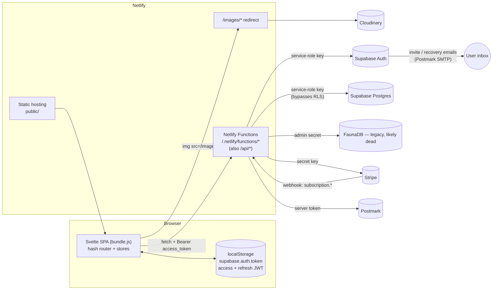
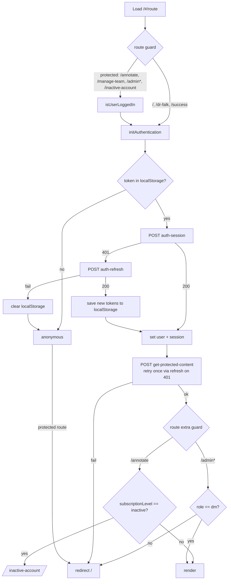
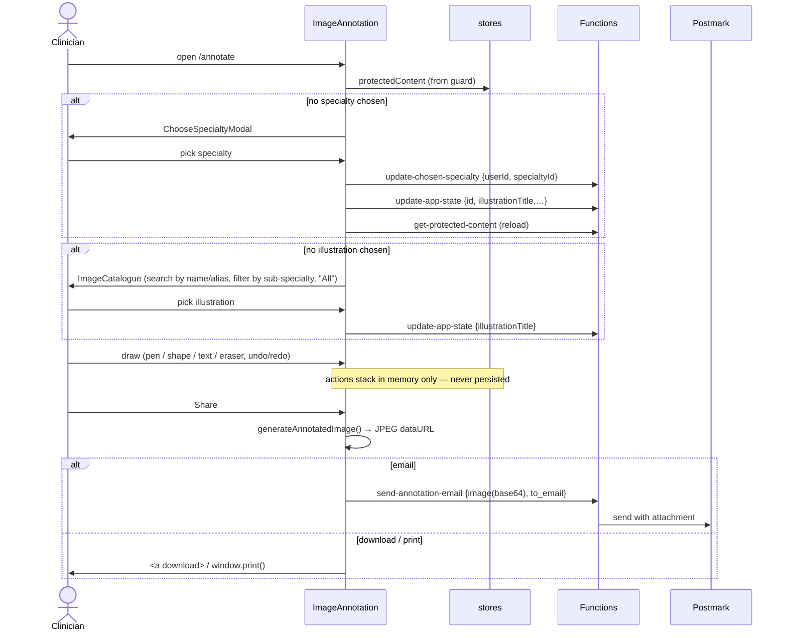
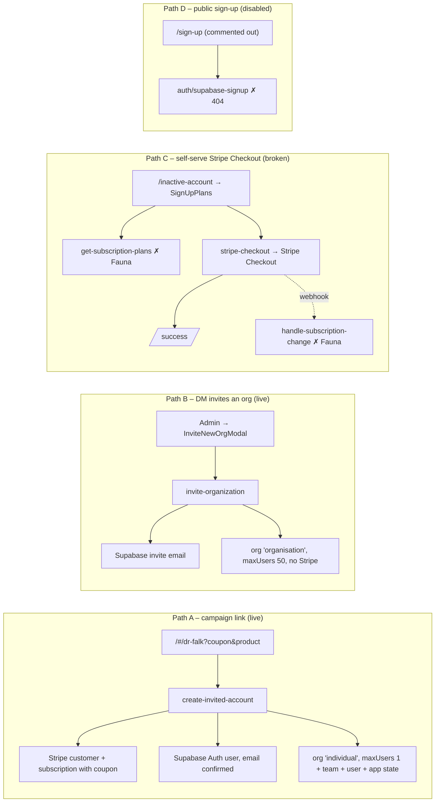

# PostScript Annotation App — Architecture & User-Flow Baseline

> **Purpose:** a snapshot of the system as it stands on `staging` (commit `67f2818`, 2026-02-13). It is meant as the starting map for planning the next migration.
> **Superseded where it recommends:** this is a record of the current system. Its §10 recommendations (including the hot fixes in §10.1 and the billing ideas) were input to planning, and [migration-plan.md](migration-plan.md) replaces them: no hot fixes, no billing, individual free accounts.
> **Scope:** everything in this repository. The Supabase schema, RLS policies, Stripe dashboard configuration and Netlify site settings are **not** in the repo. Where this document makes claims about them, it infers them from code and marks them _(inferred)_.

---

## 1. TL;DR

- **What it is:** a Svelte 3 single-page app on Netlify. Clinicians pick a medical illustration (grouped by specialty and sub-specialty), draw on it (pen, shapes, text, eraser), then print, download or email the result to a patient. Organisations buy seats through Stripe. Owners invite team members. Internal "DM" staff manage organisations and the illustration catalogue.
- **Backend:** about 35 Netlify Functions (Node, CommonJS). Every one of them talks to its data store with **privileged credentials** (Supabase service-role key, Fauna admin key, Stripe secret key). **The only security boundary is the hand-written authorization code inside each function.**
- **The previous migration (Netlify Identity + FaunaDB → Supabase Auth + Postgres) is only partly done.** Login, session, team listing, app state and invites are on Supabase. The **Stripe webhook, sign-up plans, the admin catalogue editor, team-member edits and team rename still call FaunaDB.** Fauna shut down its service in May 2025, so those paths are almost certainly broken today _(verify)_.
- **Several functions that need authentication have none.** They let an anonymous caller list every organisation's email and Stripe ID, open any customer's Stripe billing portal, create organisations, create subscriptions with an arbitrary coupon, and send email from the company domain. See §7. Those items should be fixed **before**, or independently of, the migration.
- **`public/index.html` loads `https://polyfill.io/v3/polyfill.min.js`.** That domain was hijacked in a 2024 supply-chain attack. Remove it immediately.

---

## 2. Tooling inventory

| Area | Tool / version (from `package.json`) | Notes |
|---|---|---|
| UI framework | Svelte `^3.59` | Svelte 3 is two majors behind (Svelte 5 uses runes). |
| Routing | `svelte-spa-router ^3.3` | Hash-based routes (`/#/annotate`). |
| Bundler | Rollup `^2.79` + `rollup-plugin-svelte-hot`, `@rollup/plugin-babel`, `terser`, `css-only` | Outputs one IIFE `public/build/bundle.js`. HMR plugin is installed but not configured for hot reload. |
| Transpile target | Babel `preset-env` → **IE 11**, `core-js@3` `useBuiltIns: usage` | `isLegacy = true` is hard-coded in [rollup.config.js](../rollup.config.js). Makes the bundle larger for browsers nobody uses now. |
| Polyfills | `whatwg-fetch`, plus **polyfill.io CDN** (see §7) | |
| Runtime CDN scripts | `js.stripe.com/v3`, GSAP 3.5.1 (cdnjs), Google Fonts (Montserrat) | No Subresource Integrity (SRI) hashes. |
| Static server (dev) | `sirv-cli` | Wrapped by `netlify dev` (port 8888 → Rollup dev port 8080). |
| Hosting / functions | Netlify (`netlify.toml`), `netlify-cli ^10` | Functions dir `functions/`, publish `public/`. Redirects: `/images/*` → Cloudinary, `/api/*` → functions. |
| Image CDN | Cloudinary (`res.cloudinary.com/postscript-medical`) | Proxied through Netlify redirect with `q_auto:eco`. Thumbnails use URL transforms in [src/constants/defaults.js](../src/constants/defaults.js). |
| Auth | **Supabase Auth** (via server functions only) | `gotrue-js` (Netlify Identity) still in deps, unused in `src/`. |
| Database | **Supabase Postgres** (`@supabase/supabase-js ^2.49`) and **FaunaDB** (`faunadb ^4.8`, legacy) | No migrations or schema files in the repo. |
| Payments | Stripe (`stripe ^10.17` server, Stripe.js v3 client) | Checkout, Billing Portal, webhooks. |
| Email | Postmark (`postmark ^3.11`) | Streams: `annotated-image`, `feedback-form`, `supabase-auth`. HTML templates for Supabase emails in `public/template-*.html`. |
| Testing | Playwright `^1.44` (E2E + experimental Svelte component testing), Percy visual snapshots | ~19 tests. They run against the **Netlify staging preview**, not a local server. No unit tests for functions. |
| CI | GitHub Actions [.github/workflows/playwright.yml](../.github/workflows/playwright.yml) | On push to `staging` and on PRs to `staging`/`main`. Waits for the Netlify preview URL, then runs Playwright + Percy. |
| Lint / format | ESLint 8 (`eslint:recommended` + `svelte3` plugin), Prettier 2 + `prettier-plugin-svelte` | Run on staged files by Husky 8 + lint-staged. |
| Misc / dead deps | `mdsvex`, `svench` (one `.svench.svelte` story), `gotrue-js`, `node-fetch` (only used by dead Netlify Identity helpers) | `netlify-cli`, `sirv-cli`, `faunadb` are in `dependencies`, not `devDependencies`. |

**Environment variables used** (Netlify site settings / `.env`):
`SUPABASE_DATABASE_URL`, `SUPABASE_SERVICE_ROLE_KEY`, `FAUNA_KEY`, `STRIPE_SECRET_KEY`, `STRIPE_PUBLIC_KEY`, `STRIPE_WEBHOOK_SECRET`, `POSTMARK_TOKEN`, `SITE_URL`, `URL` (Netlify-provided), `ALLOWED_ORIGINS`, `DEVELOPMENT_CONTEXT`. CI also uses `PERCY_TOKEN`, `TEST_USERNAME`, `TEST_PASSWORD`.

---

## 3. Repository structure

```
annotation-app/
├── public/                     # Static shell served by Netlify
│   ├── index.html              # Loads bundle + 3rd-party scripts (Stripe, GSAP, polyfill.io)
│   ├── 404.html, global.css
│   └── template-*.html         # Supabase Auth email templates (invite, confirm, recovery)
├── src/                        # Svelte SPA
│   ├── main.js → App.svelte    # App.svelte = router, route guards, session bootstrap
│   ├── stores.js               # All global state (session, user, protectedContent, canvas undo stack, derived catalogue)
│   ├── screens/                # One component per route (16)
│   ├── modals/                 # Share, Feedback, ChooseSpecialty, ForgotPassword, InviteNewOrg, EditSubSpecialty, …
│   ├── components/             # Design-system "Ps*" components, sign-in/up forms, image catalogue/grid
│   │   ├── sketchpad/          # Canvas engine: SketchPad (666 LOC), toolbar UI, typed text, helpers/
│   │   ├── admin/              # NavBar, SpecialtySelector
│   │   └── icons/              # 19 SVG icon components
│   ├── methods/                # Fetch wrappers (load-*, netlify-function, update-app-state), image generation, filters
│   └── constants/              # Roles, tools, viewport breakpoints, plan names, storage key, legal URLs
├── functions/                  # Netlify Functions (Node/CommonJS) – the entire backend
│   ├── auth-*.js               # Supabase Auth proxies: login, logout, session, refresh, password reset
│   ├── get-*.js / update-*.js  # Data reads/writes (mixed Supabase & Fauna)
│   ├── invite-*.js, accept-*.js, create-invited-account.js, delete-*.js
│   ├── stripe-*.js, create-manage-link.js, handle-subscription-change.js (webhook)
│   ├── send-*-email.js         # Postmark
│   ├── identity-signup.js      # Netlify Identity event hook (legacy, Fauna)
│   ├── methods/                # Shared helpers: supabase-* (current) and netlify-* / create-organization (legacy Fauna)
│   └── utils/error-handler.js  # Standard error envelope + request IDs (adopted by about half the functions)
├── db/                         # Fauna seed data (cardiology, gastroenterology) + sample webhook payloads
├── playwright/                 # e2e/ specs, components/ tests, fixtures
├── netlify.toml, rollup.config.js, playwright*.config.ts
└── .github/workflows/playwright.yml
```

Size: about 15k lines tracked, about 5.1k of them in `functions/`. 567 commits since September 2020.

---

## 4. Runtime architecture



### 4.1 Frontend layers

| Layer | Where | Responsibility |
|---|---|---|
| Bootstrap & guards | [src/App.svelte](../src/App.svelte) | Route table; `initAuthentication()` reads the token from localStorage → `auth-session` → falls back to `auth-refresh`. Guards: `isUserLoggedIn` (also loads protected content), `isSubscriptionValid`, `isUserDm`, `hasToken`. |
| Global state | [src/stores.js](../src/stores.js) | `session`, `user`, `protectedContent` (the single "everything about me" payload), derived `organization`, `specialties → subSpecialties → illustrations`, `selectedIllustration`, the canvas `actions` undo/redo stack, `viewportType`, `dpr`, `customerPortalUrl`. |
| Data access | [src/methods/](../src/methods/) | Thin `fetch` wrappers. The token-from-store-or-localStorage logic is **copy-pasted in five files** (`netlify-function`, `load-protected-content`, `load-organizations`, `load-specialties`, `update-app-state`). |
| Screens / modals | `src/screens`, `src/modals` | Route components. They often call `fetch` directly instead of going through `methods/`. |
| Canvas engine | [src/components/sketchpad/](../src/components/sketchpad/) | Pointer/touch drawing on `<canvas>`, shapes, eraser, draggable typed-text overlays, resize rescaling, and an action log that drives undo/redo. [generate-annotated-image.js](../src/methods/generate-annotated-image.js) composites illustration + watermark + canvas + text into a JPEG. |

### 4.2 Backend function catalogue

Legend: **Auth** = checks a Supabase JWT. **AuthZ** = checks role or ownership. **Store** = data backend.

| Function | Caller (UI) | Store | Auth | AuthZ | Status |
|---|---|---|---|---|---|
| `auth-login` | SignInForm | Supabase Auth | — | — | ✅ live |
| `auth-logout` | LogOut | Supabase Auth | token | — | ⚠️ probably a no-op (see §7) |
| `auth-session` | App bootstrap, ResetPassword | Supabase Auth | token / recovery hash | — | ✅ live |
| `auth-refresh` | App bootstrap, load-protected-content | Supabase Auth | refresh token | — | ✅ live |
| `auth-password-reset-request` | Index → ForgotPasswordModal | Supabase Auth | — | — | ✅ live, anti-enumeration |
| `auth-password-reset` | ResetPassword | Supabase Auth (admin) | token | — | ✅ live |
| `get-protected-content` | every logged-in route guard | Supabase | ✅ | own row | ✅ live |
| `update-app-state` | ImageAnnotation | Supabase | ✅ | ownership ✅ | ✅ live |
| `update-chosen-specialty` | ImageAnnotation / ChooseSpecialtyModal | Supabase | ✅ | ownership ✅ | ✅ live |
| `get-management-data` | ManageTeam | Supabase | ✅ | own org | ✅ live |
| `invite-team-member` | ManageTeam | Supabase + Auth invite | ✅ | role + org ✅, **role value not validated** | ✅ live |
| `accept-team-invitation` | AcceptTeamInvitation | Supabase Auth | invite token | — | ✅ live |
| `delete-team-member` | ManageTeam | Supabase + Auth | ✅ | partial (see §7) | ✅ live |
| `update-team-member` | ManageTeam (edit row) | **Fauna** | ❌ | ❌ | 💀 likely broken |
| `update-team-properties` | ManageTeam (rename team) | **Fauna** | ❌ | ❌ | 💀 likely broken |
| `get-organizations` | AdminManageOrganizations | Supabase | ❌ **none** | ❌ | ✅ live, **exposed** |
| `invite-organization` | InviteNewOrgModal (admin) | Supabase + Auth invite | ❌ **none** | ❌ | ✅ live, **exposed** |
| `delete-organization` | AdminManageOrganizations | Supabase + Auth + Stripe | ✅ | admin/dm ✅ | ✅ live |
| `create-invited-account` | DrFalk (`/#/dr-falk?coupon&product`) | Stripe + Supabase | ❌ **none** | ❌ | ✅ live, **exposed** |
| `create-manage-link` | `customerPortalUrl` store | Stripe | ❌ (header sent, never checked) | ❌ | ✅ live, **exposed** |
| `stripe-customer-portal` | (no UI caller found) | Fauna + Stripe | ❌ | ❌ | 💀 / exposed |
| `stripe-checkout` | SignUpPlans | Stripe | ❌ | — | ✅ (public by design) |
| `get-subscription-plans` | SignUpPlans | **Fauna** | ❌ | — | 💀 likely broken |
| `handle-subscription-change` | Stripe webhook | **Fauna** | Stripe signature ✅ | — | 💀 **billing state never reaches Supabase** |
| `get-specialties` | load-specialties (unused?) | **Fauna** | ❌ | — | 💀 |
| `get-illustrations`, `get-illustrations-by-name` | AdminIllustrations, EditSubSpecialtyModal | **Fauna** | ❌ | — | 💀 |
| `update-illustration-details`, `update-sub-specialty-details` | Admin screens | **Fauna** | ❌ | ❌ | 💀 |
| `identity-signup` | Netlify Identity event hook | **Fauna** | ❌ | — | 💀 legacy |
| `send-annotation-email` | ShareModal | Postmark | ❌ **none** | — | ✅ live, **exposed** |
| `send-feedback-email` | FeedbackModal | Postmark | ❌ | — | ✅ live, exposed |
| _(missing)_ `auth/supabase-signup`, `auth/supabase-confirm-signup` | SignUp, SignUpForm, ConfirmSignUp | — | — | — | ❌ **404**. Functions were moved to the top level in `1164520` but these were never created. `/sign-up` route is commented out. |

### 4.3 Data model _(inferred from Supabase queries)_

```mermaid
erDiagram
  organizations ||--o{ teams : has
  teams ||--o{ users : has
  users ||--|| user_app_states : has
  user_app_states }o--o| specialties : selected
  user_app_states }o--o| sub_specialties : selected
  user_app_states }o--o| illustrations : selected
  specialties ||--o{ specialty_sub_specialties : ""
  sub_specialties ||--o{ specialty_sub_specialties : ""
  sub_specialties ||--o{ sub_specialty_illustrations : ""
  illustrations ||--o{ sub_specialty_illustrations : ""

  organizations { uuid id; text name; text email; text stripe_id; int max_users; text subscription_level; text available_specialties; text original_source_id }
  teams { uuid id; text name; uuid organization_id; text original_source_id }
  users { uuid id; uuid auth_id; text netlify_id; text email; text first_name; text last_name; text role; uuid team_id; bool show_tutorial; text original_source_id }
  user_app_states { uuid id; uuid user_id; uuid selected_specialty_id; uuid selected_sub_specialty_id; uuid selected_illustration_id }
  illustrations { uuid id; text name; text src; bool default_illustration; text_arr illustration_aliases }
```

- **Roles** (`users.role`): `user`, `owner` (org owner, manages team), `admin`, `dm` (internal PostScript staff; the only role the `/admin` UI allows in). Roles are also mirrored into Supabase Auth `app_metadata.roles` for owners only.
- **Organisation ↔ owner link is implicit.** The owner is "the `users` row with `role='owner'` whose email equals `organizations.email`". There is no FK.
- `original_source_id` and `netlify_id` are leftovers from the Fauna/Netlify migration.
- Plans: `free`, `individual`, `department`, `organization` (constants), but the code also writes `"organisation"` (British spelling) in `invite-organization`, plus `inactive`. These are inconsistent string values.

---

## 5. User journeys (personas)

| Persona | Goal | Entry point | Key screens |
|---|---|---|---|
| **Clinician (user)** | Annotate an illustration and give it to a patient | Login `/#/` | `/annotate` → catalogue → canvas → share/print/download |
| **Org owner** | Same as clinician, plus manage seats and billing | Login, or a sign-up link | `/annotate`, `/manage-team`, Stripe portal, `/inactive-account` |
| **Invited team member** | Join their organisation | Supabase invite email | `/accept-team-invitation?token=` → login → `/annotate` |
| **Campaign / partner sign-up** | Self-serve account with a coupon | `/#/dr-falk?coupon=…&product=…` | DrFalk form → login |
| **DM (internal staff)** | Onboard organisations, curate catalogue | Login → user menu → Admin | `/admin`, `/admin/organizations`, `/admin/illustrations`, `/admin/sub-specialties` |
| **Patient (indirect)** | Receive annotated image | Email from Postmark | JPEG attachment only; no app access |

---

## 6. User flows

### 6.1 App bootstrap & route guarding



Notes:
- `get-protected-content` runs again on **every protected navigation**. It returns the whole specialty → sub-specialty → illustration tree each time.
- `/admin*` gating is **client-side only**. The data functions behind it either check roles themselves or check nothing (§7).

### 6.2 Login / logout / password reset

1. **Login:** `SignInForm` → `auth-login` (service-role client calls `signInWithPassword`) → returns `access_token`, `refresh_token`, `user` → stored as plain JSON in `localStorage["supabase.auth.token"]` → `push('/annotate')`. The "stay logged in" checkbox is collected but never used.
2. **Logout:** `/log-out` → `auth-logout` (attempts `setSession({refresh_token:""})` + `signOut`) → clears localStorage and stores.
3. **Forgot password:** ForgotPasswordModal → `auth-password-reset-request` (always 200) → Supabase sends a recovery email with redirect `${SITE_URL}/#/reset-password` → `ResetPassword` pulls `access_token`/`token_hash` out of the URL hash (handles the `#/route#access_token=` double hash) → `auth-session` checks it (`getUser`, then `verifyOtp(recovery)`, then `setSession`) → user enters a new password → `auth-password-reset` (`admin.updateUserById`).

### 6.3 Core flow — annotate & share



Annotations are **ephemeral**. Only the *selected* specialty, sub-specialty and illustration persist (`user_app_states`). Images are sent by email as attachments and never stored server-side. That is good for data minimisation, but the email body itself counts as patient communication.

### 6.4 Team management (owner)

`UserSettingsDropdown` (owner only) → `/manage-team` → `get-management-data` (org, team, all members, `maxUsers`).

- **Invite:** add row (default role `user`) → `invite-team-member` → Supabase `inviteUserByEmail` (redirect `/#/accept-team-invitation`) + insert `users` and `user_app_states` rows (with compensating deletes on failure).
- **Accept:** email link → `/accept-team-invitation?token=` → `accept-team-invitation` (`verifyOtp(invite)`, then `updateUser({password})`) → `push('/annotate')`. **No session is stored after this**, so the guard sends the user back to login (see §8 UX).
- **Edit member / rename team:** `update-team-member` / `update-team-properties` → **Fauna (broken)**.
- **Remove:** `delete-team-member` → deletes Auth user, app state, user row.
- **Seat limit** (`maxUsers - members`) is enforced **only in the UI**.

### 6.5 Acquisition & billing



- **Subscription lifecycle is disconnected from Supabase.** The webhook writes only to Fauna. Upgrades, downgrades and cancellations in Stripe therefore never change `organizations.subscription_level` or `max_users`. The `/inactive-account` gate never fires for a cancelled customer _(verify in prod data)_.
- **Billing portal:** the `customerPortalUrl` store calls `create-manage-link` with `$organization.stripeID`. `get-protected-content` never returns `stripeID`, so the link is probably broken in the UI. Meanwhile the endpoint accepts any `stripeID` from anyone.

### 6.6 Internal admin (DM)

- `/admin/organizations`: list (`get-organizations`), invite (`invite-organization`), delete (`delete-organization`: cascades users, teams and org, deletes the owner's Auth user and the Stripe customer).
- `/admin/illustrations`, `/admin/sub-specialties`: catalogue CRUD over **Fauna (broken)**. **There is currently no working way to edit the Supabase catalogue from the app.**

---

## 7. Security risks

Severity reflects exploitability by an anonymous or low-privilege user against production. This is a code-level read. Supabase RLS and Netlify settings were not inspected.

### Critical

| # | Risk | Where | Impact |
|---|---|---|---|
| S1 | **Compromised third-party script**: `polyfill.io` (hijacked in June 2024 supply-chain attack) loaded on every page | [public/index.html:14](../public/index.html#L14) | Arbitrary JS in the app origin. It can read the JWTs in localStorage (S9) and patient-related content. Remove now. It is not needed: Babel + core-js already polyfill. |
| S2 | **Unauthenticated org directory**: returns every org's id, owner email, auth ID and **Stripe customer ID** | [functions/get-organizations.js:4](../functions/get-organizations.js#L4) | Leaks the customer list. Feeds S3. |
| S3 | **Unauthenticated Stripe billing portal for any customer** | [functions/create-manage-link.js:6](../functions/create-manage-link.js#L6), also `stripe-customer-portal.js` | With a Stripe ID from S2, anyone gets a live portal session: view invoices, payment-method details and addresses; cancel or change subscriptions. |
| S4 | **Privilege escalation via invite**: `role` comes from the request body and is written unvalidated | [functions/invite-team-member.js:28](../functions/invite-team-member.js#L28) (`role: role` at L187) | An org owner can invite a user (or a second email they control) as `dm` or `admin`. `dm` = platform staff (admin UI, delete-any-org, delete-any-user). |
| S5 | **Unauthenticated org creation** | [functions/invite-organization.js:19](../functions/invite-organization.js#L19) | Anyone can mint 50-seat "organisation" accounts and trigger Supabase invite emails to arbitrary addresses (spam, free licences). |
| S6 | **Unauthenticated paid account creation with caller-chosen `coupon` and `product`** | [functions/create-invited-account.js:15](../functions/create-invited-account.js#L15) | Anyone can create Stripe customers and subscriptions with any coupon (e.g. a 100% one) and get a confirmed account. It also skips email verification (`email_confirm: true`), so an attacker can pre-register a victim's address. |

### High

| # | Risk | Where | Impact |
|---|---|---|---|
| S7 | **Open email relay with attachment** from `accounts@postscriptmedical.com` | [functions/send-annotation-email.js:4](../functions/send-annotation-email.js#L4) | Phishing or spam using the company's trusted domain and Postmark reputation. No auth, rate limit or size cap. `to_email` is also interpolated into HTML unescaped. |
| S8 | **Cross-tenant deletion paths** | [functions/delete-team-member.js:110](../functions/delete-team-member.js#L110), [functions/delete-organization.js:96](../functions/delete-organization.js#L96) | `admin` and `dm` can delete any user in any org. An owner could delete another owner in their own team. `delete-organization` deletes the Stripe customer named in the **body**, not the org's own `stripe_id`. Combined with S4, an owner can escalate and then delete other tenants. |
| S9 | **Long-lived tokens in localStorage**, plus no CSP and no SRI on CDN scripts | [src/components/SignInForm.svelte:44](../src/components/SignInForm.svelte#L44), `public/index.html` | Any XSS or compromised CDN (see S1) gives account takeover through the refresh token. |
| S10 | **Logout does not revoke**: `setSession` with an empty refresh token most likely fails, so `signOut` is never called. The response says success either way. | [functions/auth-logout.js:88](../functions/auth-logout.js#L88) | Stolen refresh tokens stay valid after logout. Use `auth.admin.signOut(jwt)`. |
| S11 | **Fauna-era write functions have no auth** (`update-team-member` can set `role`; `update-illustration-details`, `update-sub-specialty-details`, `update-team-properties`, `identity-signup`) | `functions/update-*.js` | Dormant only because Fauna is gone. If anyone "fixes" them by porting the queries to Supabase without adding auth, they become a direct privilege escalation. |
| S12 | **Seat limits and subscription status enforced only client-side** | ManageTeam, App guards | Owners can exceed `max_users` by calling `invite-team-member` directly. Cancelled subscriptions are never set to `inactive` (§6.5). |

### Medium / Low

- **S13 – Shared service-role client mutated with user sessions.** `auth-login`, `auth-logout` and `auth-session` call `signInWithPassword` / `setSession` on a **module-level** client. In a warm Lambda this attaches a user session to a client that later requests reuse. It is low impact today because those clients only do auth calls, but it is a dangerous pattern to copy.
- **S14 – Inconsistent invite / reset token handling.** `accept-team-invitation` and `auth-password-reset` also accept a normal **access token** in place of the invite or recovery token. Anyone holding a session token can therefore set a new password without the old one. Normal for Supabase recovery sessions, but worth tightening.
- **S15 – CORS:** `Access-Control-Allow-Origin: *` everywhere. `ALLOWED_ORIGINS` handling returns only the first origin. The method check runs *before* the `OPTIONS` check in the `auth-*` functions, so preflights get 405.
- **S16 – HTML injection in staff emails:** `send-feedback-email` interpolates `from_name` and `message` raw into `HtmlBody`.
- **S17 – Information leaks:** some functions return raw error strings (`Webhook … ${error.message}`, `Error creating organization: ${orgError.message}`). `auth-password-reset` returns env-var names. Server logs record emails and IPs (consider GDPR / health-data logging policy).
- **S18 – No rate limiting** on login, reset or invite endpoints. Mitigation relies on Supabase's built-in limits.
- **S19 – Health-data posture.** Annotated images of patient conditions go out by email to arbitrary addresses, with no consent or audit trail. Confirm the regulatory position (UK GDPR / HIPAA, depending on market) before the migration fixes the architecture in place.
- **S20 – Unknown RLS state.** Everything server-side uses the service-role key, so RLS gives **no** protection against function bugs. If the anon key were ever shipped to the client, unknown RLS policies would become the boundary. Audit them in the Supabase dashboard.

---

## 8. Correctness & UX defects found while mapping

| Defect | Location |
|---|---|
| `dpr` store is always `2`: comma operator `(window.devicePixelRatio \|\| 1, 2)`. Probably intended `Math.min(…, 2)`. Affects canvas sharpness and export maths. | [src/stores.js:198](../src/stores.js#L198) |
| `clearLocalApplicationData` removes the token from **sessionStorage**, but the token lives in **localStorage**. It only works because `LogOut` also clears localStorage; other callers (e.g. guard failure in `App.svelte`) leave the token behind. | [src/methods/clear-local-application-data.js:20](../src/methods/clear-local-application-data.js#L20) |
| Backend errors use `{error}`, but `netlify-function.js` reads `error.message`, so users see "Server error - undefined". `AcceptTeamInvitation` reads `.message` too. | [src/methods/netlify-function.js:47](../src/methods/netlify-function.js#L47) |
| After accepting an invite, no session is stored, so `push('/annotate')` bounces to login. | `src/screens/AcceptTeamInvitation.svelte` |
| `customerPortalUrl` fires a Stripe call on every store change, with an undefined `stripeID`. | [src/stores.js:96](../src/stores.js#L96) |
| `update-app-state` is fire-and-forget. Errors are only logged to the console. Look-ups are by **name**, not id, although ids are available on the client. | `src/methods/update-app-state.js`, `functions/update-app-state.js` |
| Several Fauna functions return `undefined` from `.catch`, which makes Netlify respond with a 502/empty body. | `functions/get-*.js` (Fauna) |
| Webhook `.catch(() => ({statusCode:400}))` values are discarded, so Stripe always receives 200 even when processing failed. | `functions/handle-subscription-change.js` |
| `stayLogged` checkbox has no effect. | SignInForm |
| `create-invited-account` with no `coupon` sends `discounts: [{coupon: null}]` (Stripe error). There is no payment method, so it relies on a 100% coupon. | [functions/create-invited-account.js:48](../functions/create-invited-account.js#L48) |
| Rollback is partial. An Auth user created before an org-creation failure is not deleted. | `create-invited-account.js`, `invite-organization.js` |

---

## 9. Strong patterns worth keeping

1. **No database credentials in the browser.** All data access goes through server functions. The model is right; it just needs consistent enforcement (§10).
2. **The newer Supabase functions are well-shaped.** `update-app-state`, `update-chosen-specialty`, `get-protected-content`, `get-management-data` and `invite-team-member` follow a clear pattern: verify JWT, then resolve the `users` row by `auth_id`, then check ownership or role, then act. They use [functions/utils/error-handler.js](../functions/utils/error-handler.js) (stable error codes, request IDs, server-side detail only). Use this as the template for every endpoint.
3. **Auth hygiene in the `auth-*` functions:** generic error messages, jittered delay on failures, an enumeration-safe reset request, server-side password policy that mirrors the client.
4. **Compensating cleanup** in multi-step creates (`invite-team-member`, `supabase-create-organization`). It is not transactional, but the intent is right and maps well to a Postgres function or RPC later.
5. **Stripe webhook signature verification** (`constructEvent`).
6. **Annotations are not stored server-side.** This keeps the PHI footprint small.
7. **The canvas engine is self-contained.** `sketchpad/` plus the `actions` undo store (adapted from svelte-undo) has few dependencies and moves cleanly to any newer Svelte.
8. **Image delivery** through a Netlify → Cloudinary redirect with URL-based transforms, so no image-processing code is needed.
9. **Clear store derivation chain** (`protectedContent → specialties → subSpecialties → illustrations`) that de-duplicates "All".
10. **E2E safety net on the real deployed preview**, with visual regression (Percy) and an auth setup project that reuses storage state.

---

## 10. Possible improvements (migration input)

Grouped roughly by when they should happen relative to the migration.

### 10.1 Before migrating (hot fixes, small diffs)
1. Remove `polyfill.io` (S1). Add SRI to the Stripe and GSAP tags, or self-host GSAP.
2. Add JWT + role checks to `get-organizations`, `invite-organization`, `create-manage-link`, `stripe-customer-portal` (or delete it), `send-annotation-email` and `send-feedback-email`. Derive `stripeID` server-side from the caller's org (S2, S3, S5, S7).
3. Allow-list `role` in `invite-team-member` (owners may grant only `user`/`owner`). Enforce `max_users` server-side (S4, S12).
4. Lock down `create-invited-account`: allow-list coupon and price pairs server-side, or replace it with Stripe Checkout + webhook (S6).
5. Scope `delete-team-member` and `delete-organization` to the tenant, and use the org's stored `stripe_id` (S8).
6. Port `handle-subscription-change` to Supabase so billing state is real (§6.5).
7. Delete or quarantine all Fauna functions and helpers (`functions/methods/netlify-*`, `create-organization.js`, `update-org-subscription-*`), plus the `faunadb`, `gotrue-js` and `node-fetch` deps (S11).

### 10.2 Architecture choices for the migration
- **Framework:** Svelte 3 + Rollup + IE11 Babel → **SvelteKit (Svelte 5) + Vite**, or at least Vite + Svelte 5 SPA. Drop the IE11 target, `whatwg-fetch`, `core-js` and the `msSaveBlob` branches. This gets HMR, ES modules, code-splitting (admin screens are currently in the main bundle) and TypeScript.
- **Routing:** hash routing → path routing (needs Netlify SPA fallback). Move route guards into a single `load`/hook layer instead of `conditions` callbacks that mutate global `isLoading`.
- **Auth model:** pick one of these and apply it everywhere:
  - (a) **Keep the BFF.** Functions own auth. Move tokens into **httpOnly, Secure, SameSite cookies** set by `auth-login`/`auth-refresh` (removes S9). Or:
  - (b) **Use `@supabase/supabase-js` in the browser with the anon key plus strict RLS**, and keep functions only for privileged operations (invites, Stripe, email). Option (b) removes many boilerplate functions, but RLS becomes the security boundary. It must be written and tested (S20).
- **Backend structure:** collapse 35 single-file handlers into a small set of modules sharing middleware: `withAuth()`, `withRole([...])`, `withOrgScope()`, input validation (e.g. zod), the CORS policy, and the existing error-handler. Today the CORS helper, the client factory and the token-extraction block are each duplicated about ten times.
- **Database:** add the schema to the repo (Supabase CLI migrations). Make the org → owner relation explicit (`organizations.owner_user_id`). Normalise `subscription_level` into an enum (fix `organisation` vs `organization`). Drop `netlify_id` and `original_source_id` once nothing reads them. Move multi-step creates and deletes into **Postgres functions / RPC** so they are transactional.
- **Data loading:** split `get-protected-content`. The catalogue (specialties → illustrations) is the same for every user and cacheable (CDN or `stale-while-revalidate`). Per-user state is small. Stop refetching on every route change.
- **Billing:** make Stripe the source of truth via webhooks (`customer.subscription.*`, `checkout.session.completed`) → Supabase. Store `stripe_customer_id`, `price_id`, `status` and `current_period_end`. Make the portal endpoint derive the customer from the caller.
- **Admin catalogue:** rebuild on Supabase, or manage it in the Supabase table editor and Cloudinary directly. Today it cannot be edited at all.
- **Email:** keep Postmark, but authenticate, rate-limit and log `send-annotation-email`. Consider a consent checkbox and an audit row (who sent what to which address, without the image) for compliance (S19).

### 10.3 Quality & developer experience
- **Front-end data access:** one `api()` client that handles token lookup, refresh-on-401, the error shape and the `isLoading` state, instead of five copies plus inline `fetch` calls in screens.
- **TypeScript** for functions and shared DTOs. Today, response shapes are hand-maintained "to match original FaunaDB structure".
- **Tests:**
  - Add unit and integration tests for functions (authz matrices especially) that can run locally or in CI against a Supabase branch or local stack.
  - Let Playwright also run against `netlify dev` (the `webServer` block is commented out).
  - Re-enable WebKit, since iPad is a likely clinical device.
- **Dependencies:** remove `mdsvex`, `svench`, `rollup-plugin-svelte-hot`, `gotrue-js`, `faunadb` and `node-fetch`. Move `netlify-cli` and `sirv-cli` to devDeps. Upgrade `stripe` (v10 → current), `eslint` 8 → 9 (flat config), `prettier` 2 → 3 and `husky` 8 → 9.
- **Observability:** structured logs exist in about half the functions. Standardise them and ship to a log drain. Add alerting on webhook failures.
- **Housekeeping:** remove the dead sign-up screens (`SignUp`, `SignUpForm`, `ConfirmSignUp`) or wire them to real endpoints. Rename `DrFalk` to a generic `CampaignSignUp` with server-side campaign config. Fix the defects in §8.

---

## 11. Open questions for the migration plan

1. Is Fauna really dead in production, or are any `FAUNA_KEY` paths still answering? (Check Netlify function logs for `get-subscription-plans` and `handle-subscription-change`.)
2. What RLS policies exist on the Supabase tables, and is the anon key used anywhere (other apps, scripts)?
3. Which acquisition paths matter going forward: campaign links (DrFalk), DM-invited orgs, or self-serve Checkout?
4. Who are `admin` vs `dm` in practice? Should `admin` exist at all?
5. Target markets and regulatory regime for patient-facing email (drives S19 and data residency for Supabase/Postmark).
6. Browser and device support matrix (removing IE11 is assumed; confirm iPad/Safari share).
7. Is the multi-team-per-org concept needed? Code and UI assume a single team per org (`My team`).
