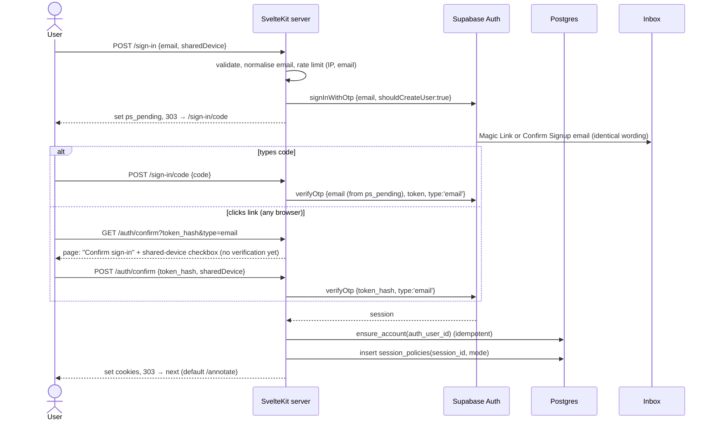

# PostScript Annotation App — Authentication & Authorization Spec

> **Companions:** [migration-plan.md](migration-plan.md) (auth model, layout, phases), [data-model.md](data-model.md) (tables and RPCs named here), [data-protection.md](data-protection.md) (what auth stores and for how long), [architecture-baseline.md](architecture-baseline.md) (risk IDs like S10).
> **Status:** draft, revised 2026-10-21. Sign-up asks for an **email address only**. Invites, team roles and billing checks are out of the launch scope.

---

## 1. Decisions

| Topic | Decision |
|---|---|
| Sign-up | **Email address only.** No name, organisation, country or terms checkbox. Sign-in and sign-up are **the same form**: entering an unknown address creates the account once the code is verified. |
| Credentials | **No passwords.** Every sign-in uses an emailed **magic link plus a 6-digit code**, and either one works. |
| Scanner safety | Opening the link shows a page with a **"Confirm sign-in" button**. The token is used only on POST, so email security scanners (NHSmail / Microsoft Safe Links) that open links can't use it up. |
| Identity | **One login per person**, tied to their email address. |
| Session length | The user picks at sign-in: **personal device** (30 days, sign out after 7 days idle) or **shared device** (8 hours, sign out after 60 minutes idle, cleared when the browser closes). **Both are enforced by the app**, because the Supabase free tier has no session time-box. |
| MFA | **None at launch.** Room for TOTP later (§9). |
| Where auth runs | Only on the server: `@supabase/ssr` in `hooks.server.ts` with httpOnly cookies. No Supabase client or key in the browser. |
| Roles | **Platform role** on `users`: `user` or `dm` (staff). **Workspace role** on `workspace_members`: `owner` or `member`. At launch every user is `owner` of their own personal workspace and nothing reads workspace roles yet. Nothing is copied into `app_metadata`. |
| Invites | **Not at launch.** They return with organisation accounts ([data-model §6](data-model.md)). |

---

## 2. Supabase configuration

Kept in the repo as `supabase/config.toml` and `supabase/templates/*.html`, then pushed to both projects with the Supabase CLI. Phase 0: check that `config push` covers templates and every setting below on hosted projects. Anything it doesn't cover goes on a dashboard checklist in this doc.

| Setting | Value | Why |
|---|---|---|
| Email provider | On. **Confirm email: on.** | Verifying the code is the confirmation. |
| Allow new users to sign up | **On** | Open sign-up. |
| Email OTP length | 6 | |
| Email OTP expiry | **900 s (15 min)** | Hospital mail can be slow. |
| Minimum interval between emails per user | 60 s | Supabase default. Prevents resend spam. |
| Project-wide email rate limit (custom SMTP) | **Raise from the default**, within the email provider's limit | Every sign-in sends an email. |
| SMTP | Custom SMTP, provider to be chosen ([migration-plan §11.1](migration-plan.md)) | SPF, DKIM and DMARC aligned for the sending domain. NHSmail is strict. |
| Site URL / redirect allow-list | One per environment (staging site, production domain) | |
| JWT signing keys | **Asymmetric** (the new signing keys) | Lets the hook verify JWTs locally with `getClaims()` (§3.2), saving an Auth round trip per request. |
| Auth audit log in the database | **Off** if the setting is available, otherwise purged after 30 days by pg_cron | It stores IP addresses ([data-protection §6](data-protection.md)). |
| Anonymous sign-ins, phone, OAuth | Off | |
| API keys | The new **publishable / secret** keys, server-side only. Rotate at cutover (§8). | |
| Session time-box / inactivity | Not available on free. If we upgrade, set **30 days / 7 days** as a backstop to §5. | |

### 2.1 Email templates

Templates use `{{ .TokenHash }}` and `{{ .Token }}`, **never `{{ .ConfirmationURL }}`**. ConfirmationURL sends the user through Supabase's PKCE redirect, which only works in the browser that requested it. A token hash can be verified on our server from any browser.

| Template | Used for | Contents |
|---|---|---|
| Magic Link | sign-in for existing users | "Your PostScript sign-in code". Button → `{{ .SiteURL }}/auth/confirm?token_hash={{ .TokenHash }}&type=email`. Then the code `{{ .Token }}`, "expires in 15 minutes", "if you didn't request this, ignore it". |
| Confirm Signup | first sign-in of a new address | **Identical wording and layout** to Magic Link, so the email doesn't reveal whether the address already had an account. |
| Change Email, Invite, Recovery, Reauthentication | **not used** | |

The code goes in the email body (and preheader), **not the subject line**, so it doesn't show on lock screens. Templates contain no tracking pixels and no click-tracking redirects (turn link tracking off at the email provider).

---

## 3. Cookies and session handling

### 3.1 Cookies

All cookies are strictly necessary, so no consent banner is needed ([data-protection §5](data-protection.md)).

| Cookie | Set by | Contents | Flags |
|---|---|---|---|
| `sb-<ref>-auth-token` (chunked) | `@supabase/ssr` | Supabase session | `HttpOnly; Secure; SameSite=Lax; Path=/`. **Personal:** `Max-Age` 30 days. **Shared:** no `Max-Age` (session cookie). |
| `ps_pending` | `/sign-in` action | Signed: email, mode (personal/shared), issued-at | `HttpOnly; Secure; SameSite=Lax; Path=/sign-in; Max-Age=900` |

`createServerClient` is passed `cookieOptions: { httpOnly: true, secure: true, sameSite: 'lax' }`. The `@supabase/ssr` default isn't httpOnly, because it assumes a browser client that we don't have.

### 3.2 `hooks.server.ts` order

1. Build the per-request SSR client (`event.locals.supabase`).
2. `const { data } = await supabase.auth.getClaims()`. This verifies the JWT signature against the project's JWKS, so `getSession()` alone is never trusted. It gives us `sub` and `session_id`.
3. When there are claims, look up the `session_policies` row by `session_id` and apply §5. **No row → sign out.** Every session we create has a row, so a missing row means it was revoked (sign-out elsewhere, account deletion) or created outside our flows.
4. Load `locals.profile`: `{ userId, platformRole, workspaceId, workspaceRole }` in one query (`users` join `workspace_members`). No row → call `ensure_account` (covers a failure between verification and account creation).
5. Security headers (CSP etc., migration-plan Phase 1).

`getClaims()` doesn't notice a revoked session until the JWT expires (up to 1 hour). Step 3 closes that gap: revocation deletes the policy row, and the next request signs out.

### 3.3 CSRF

Every state-changing request is a SvelteKit **form action** or a same-origin POST. SvelteKit checks the origin on these by default, and `SameSite=Lax` adds another layer.

---

## 4. Flows

### 4.1 Sign-in and sign-up (one flow)

- **One form:** "Enter your email to sign in or create an account." Below it: "By continuing you agree to the [Terms](/terms) and [Privacy notice](/privacy)." No checkbox and nothing stored. Agreeing to terms isn't GDPR consent; the lawful basis is the contract ([data-protection §3](data-protection.md)).
- **Same screen and same email whether or not the account exists**, so the form can't be used to discover who has an account.
- **Account creation happens only after verification.** `ensure_account` creates the `users` row, the personal workspace, the `owner` membership and the app state in one transaction. Supabase does create an `auth.users` row when the code is requested. pg_cron deletes rows that are still unconfirmed after 24 hours.
- **Code screen:** a 6-digit numeric input with `autocomplete="one-time-code"`, a **Resend** button (disabled for 60 s), and "Use a different email".
- **Wrong code:** a generic error. After **5 wrong attempts** for an address within 15 minutes, `ps_pending` is invalidated and a new code is needed (§6).
- **`next` parameter:** must be a relative path on our own site, otherwise it's ignored (prevents open redirects).
- **Device choice:** asked on whichever screen completes sign-in. It defaults to **shared device** when we can't tell, because that's the safer default.
- **Email normalisation:** trim and lower-case only. No removal of `+tags` or dots, which would change the address the user typed.

### 4.2 Sign-out

- `/logout` (POST, form action): `supabase.auth.signOut({ scope: 'local' })` revokes this session's refresh token. The `session_policies` row is deleted and cookies are cleared (fixes S10).
- `/account` → **"Sign out of all devices"**: `signOut({ scope: 'global' })` + delete all of that user's `session_policies` rows.

### 4.3 Account page (`/account`)

| Section | What it does |
|---|---|
| Email | Shows the address. Changing it isn't offered at launch: the user deletes the account and signs up with the new address, losing only preferences. |
| Sessions | The user's `session_policies` rows: mode, started, last seen, "this device". Sign out one, or all. No IP or device details are stored or shown. |
| Download my data | `export_account(auth_id)` → a JSON file: email, account created and last sign-in dates, platform role, workspace, app state, sessions. Covers the rights of access and portability. |
| Delete my account | Confirmation by typing the email address. Then Admin API `deleteUser(auth_id)`. The FK cascade removes `users`, the personal workspace, memberships, app state and session policies. The cookies are cleared → `/sign-in?deleted=1`. |

Staff (`dm`) accounts can't self-delete while they are the last `dm` (checked in the action).

### 4.4 Changing the device choice

Only at sign-in. To switch, the user signs out and back in.

---

## 5. Session policy (personal vs shared)

The Supabase free tier has no time-box or inactivity setting, so the app enforces both modes.

**Table `session_policies`** ([data-model §3](data-model.md)): `session_id uuid primary key` (Supabase JWT `session_id` claim), `user_id`, `mode` (`personal|shared`), `created_at`, `last_seen_at`. RLS on, no policies.

| | Personal | Shared |
|---|---|---|
| Absolute lifetime | **30 days** from `created_at` | **8 hours** from `created_at` |
| Idle timeout | **7 days** since `last_seen_at` | **60 minutes** since `last_seen_at` |
| Cookie persistence | `Max-Age` 30 days | Browser-session cookie |
| Expired → | Hook calls `signOut({scope:'local'})`, deletes the row → `/sign-in?expired=1` | Same |

- `last_seen_at` is updated at most once every 5 minutes per session, so we don't write to the database on every request.
- Supabase's own refresh tokens don't expire without the time-box setting. They're useless without a policy row, though, because the hook signs out any session that has none.
- pg_cron deletes policy rows past their absolute lifetime, and the matching `auth.sessions` rows ([data-protection §6](data-protection.md)).

---

## 6. Abuse controls

Open sign-up means anyone can make us send a code to any address, so the request limits matter. Rate limits use the Postgres-backed limiter (`lib/server/rate-limit.ts`). Keys are **HMAC-SHA256 hashes** of the email or the IP's /24 (IPv4) or /48 (IPv6) prefix, using a server secret. Rows are deleted after 24 hours. All limits are constants, tuned after launch.

| Action | Limit | Response when hit |
|---|---|---|
| Request code (`/sign-in`, resend) | 5 per email per hour, 20 per IP prefix per hour | The same "check your email" screen. Nothing is sent. |
| Verify code | 5 wrong attempts per email per 15 min | Code invalidated, "request a new code" |
| Confirm page POST | 20 per IP prefix per 15 min | Generic error |
| Feedback | 5 per user per day | Error shown to the user |

Plus the Supabase-side limits from §2. If code requests are abused for email bombing, add Supabase's built-in CAPTCHA (Cloudflare Turnstile) to `/sign-in`. That brings in a new processor, so update data-protection §4 before enabling it.

Sign-in events are logged with the **user id only** (no email, no IP). Failed attempts are logged with the hashed key (S17).

---

## 7. Authorization

### 7.1 Roles

| Role | Where | Can |
|---|---|---|
| `user` (platform) | `users.platform_role` | Use the full catalogue, their own app state, share on device, feedback, their own account page. |
| `dm` (platform) | `users.platform_role` | Everything `user` can, plus the staff catalogue admin. Set **only by a database migration or a staff SQL script**, never by the app (S4). |
| `owner` / `member` (workspace) | `workspace_members.role` | Not checked at launch. Every user owns their personal workspace. Used when organisations arrive ([data-model §6](data-model.md)). |

**No action accepts a user id or workspace id from the client at launch.** Identity and scope always come from `locals.profile`.

### 7.2 Guards

| Guard | Checks | Fails with |
|---|---|---|
| `requireUser(event)` | `locals.user` and `locals.profile` exist | 303 → `/sign-in?next=…` |
| `requireStaff(event)` | `locals.profile.platformRole === 'dm'` | 403 |
| _later:_ `requireWorkspaceRole(event, roles)` | membership role in the active workspace | 403 |
| _later:_ `requireSameWorkspace(event, workspaceId)` | target row belongs to the active workspace | **404** (doesn't reveal that other tenants' rows exist) |
| _later:_ `requireFeature(event, feature)` | the active workspace has the feature entitlement | 403 → upgrade page |

Route groups apply them in layouts: `(app)` → requireUser, `(admin)` → requireUser + requireStaff. **Every action and `+server.ts` handler calls its guards again.** It never relies on the layout alone, because SvelteKit runs actions without running the layout `load`.

### 7.3 Matrix

This is the source of truth for the authorization tests ([migration-plan §6](migration-plan.md)). ✅ allowed · ❌ denied (status) · — not applicable. "Other user" means a request that tries to reach another user's row (e.g. a forged session id).

| Route / action | anon | user | other user's resource | dm | Notes |
|---|---|---|---|---|---|
| `/sign-in`, `/sign-in/code`, `/auth/confirm` | ✅ | ✅ (→ /annotate) | — | ✅ (→ /annotate) | Rate-limited (§6) |
| `/privacy`, `/terms` | ✅ | ✅ | — | ✅ | |
| `POST /logout` | ❌ 303 | ✅ | — | ✅ | |
| `/annotate` load | ❌ 303 | ✅ | — | ✅ | |
| `annotate?/chooseSpecialty`, `?/chooseIllustration` | ❌ 303 | ✅ own state; ids must exist in the catalogue | ❌ (no user id accepted) | ✅ | |
| `?/feedback` | ❌ 303 | ✅ | — | ✅ | Rate-limited (S16) |
| `/account` load | ❌ 303 | ✅ own | — | ✅ own | |
| `account?/signOutSession` | ❌ 303 | ✅ own session | ❌ 404 | ✅ own | |
| `account?/signOutEverywhere` | ❌ 303 | ✅ | — | ✅ | |
| `account?/export` | ❌ 303 | ✅ own | — | ✅ own | |
| `account?/delete` | ❌ 303 | ✅ own, email typed | — | ✅ own, not the last `dm` | |
| `/admin/**` load + actions | ❌ 303 | ❌ 403 | — | ✅ audited | |

A Vitest helper creates two users and one staff user in the local Supabase stack and runs every row of this table against every column.

---

## 8. Moving existing users over (at cutover)

The data side (workspaces, role mapping, dropping orgs) is in [data-model §7](data-model.md). The auth side:

- **Existing Supabase Auth users** keep their accounts and `users.auth_id` links. They just start signing in with a code. The cutover email ([migration-plan Phase 4](migration-plan.md)) says: "PostScript is now free. You no longer need a password. Enter your email and we'll send you a code."
- **Old passwords are scrambled:** a one-off script sets a random 64-byte password on every Auth user (Admin API `updateUserById`). Then nobody can sign in with a password even if a key leaks.
- **Old pending invites and unconfirmed Auth users** are deleted, along with any `users` row linked to them. With open sign-up they can simply sign up themselves.
- **`app_metadata.roles` and `user_metadata`** (names, `pending_org` and similar) are cleared from every Auth user.
- **API keys** rotated (old anon and service-role keys revoked). Supabase Auth redirect URLs switched to the production domain.

---

## 9. Removed, and kept open for later

| Item | Status |
|---|---|
| `auth-login`, `auth-password-reset-request`, `auth-password-reset`, `ForgotPasswordModal`, `ResetPassword`, `CredentialsForm`, `check-password-requirements.js`, "stay logged in" checkbox, `template-identity-recovery.html` | **Deleted** |
| `auth-session`, `auth-refresh`, `accept-team-invitation`, `AcceptTeamInvitation` | Replaced by `hooks.server.ts` and `/auth/confirm` |
| `/sign-up`, `/onboarding`, the "no account" notice email | **Dropped.** One email-only form covers both. |
| Invites (`/invite/[token]`, `team_invites`) | Later, with organisations ([data-model §6](data-model.md)). The scanner-safe design from the previous draft still applies: hashed tokens, viewing the page changes nothing, the invitee signs in through the normal code flow. |
| TOTP MFA | Not at launch. Supabase MFA (`aal2`) can later be required for `dm` in `requireStaff`, with an enrolment page under `/account`. |
| Passkeys / SSO (NHS login, Microsoft Entra for trusts) | Not planned. Org-level SSO would slot in as another way of creating a session, before `session_policies`. |

---

## 10. Open questions

1. **Shared-device limits:** 8 h absolute / 60 min idle. Right for clinic workflows, or should idle be shorter (e.g. 15 min)?
2. **Email change:** not offered at launch (delete and sign up again). OK while accounts hold only preferences?
3. **Auth email volume:** each sign-in is one email. The provider choice ([migration-plan §11.1](migration-plan.md)) must carry it.
