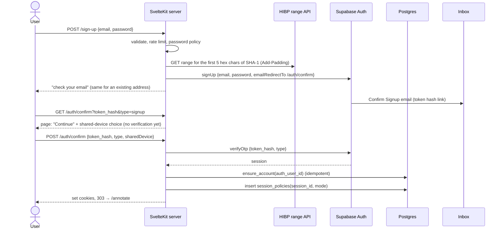

# PostScript Annotation App — Authentication & Authorization Spec

> **Companions:** [migration-plan.md](migration-plan.md) (auth model, layout, phases), [data-model.md](data-model.md) (tables and RPCs named here), [data-protection.md](data-protection.md) (what auth stores and for how long), [architecture-baseline.md](architecture-baseline.md) (risk IDs like S10).
> **Status:** draft, revised 2026-11-03. Sign-up asks for an **email address and a password**, nothing else. Invites, team roles, staff roles and billing checks are out of the launch scope. Steps: [migration-execution-plan.md](migration-execution-plan.md) (scope change 4, 1.7–1.12).

---

## 1. Decisions

| Topic | Decision |
|---|---|
| Sign-up | **Email address + password.** No name, organisation, country or terms checkbox. `/sign-up` is its own form. **Confirm email is on:** Supabase sends one confirmation email, and the app account (`ensure_account`) is created on the first verified sign-in. Signing up with an address that already has an account gets the same "check your email" response. |
| Credentials | **Email + password.** The email address is the username; no separate username is stored. No magic links or sign-in codes. A password is the only factor, which drives the policy below. |
| Password policy | Following **NIST SP 800-63B-4** and **NCSC** guidance: **at least 15 characters**, up to **72 bytes** (bcrypt's limit in Supabase Auth). **No composition rules, no expiry**, no hints or security questions. Any characters, including spaces and emoji, **NFKC-normalised** before hashing. **Checked against breached passwords** (HIBP range API, §2) with a bundled fallback list, plus the app's own words and the user's email address. Paste allowed, `autocomplete="new-password"` / `"current-password"`, a show-password toggle, hint "Try three random words". A change is forced only on evidence of compromise. One shared validator (`src/lib/server/password.ts`) for sign-up, reset and change password. |
| Scanner safety | Confirmation and reset links open a page with a **"Continue" button**. The token is used only on POST, so email security scanners (NHSmail / Microsoft Safe Links) that open links can't use it up. |
| Identity | **One login per person**, tied to their email address. |
| Session length | The user picks at sign-in (or on the `/auth/confirm` page): **personal device** (30 days, sign out after 7 days idle) or **shared device** (8 hours, sign out after 60 minutes idle, cleared when the browser closes). **Both are enforced by the app**, because the Supabase free tier has no session time-box. |
| MFA | **None at launch.** Room for TOTP later (§9). |
| Where auth runs | Only on the server: `@supabase/ssr` in `hooks.server.ts` with httpOnly cookies. No Supabase client or key in the browser. |
| Roles | **No platform roles:** every account is a plain user, and there is no staff role or `/admin` area in this migration. **Workspace role** on `workspace_members`: `owner` or `member`. At launch every user is `owner` of their own personal workspace and nothing reads workspace roles yet. Nothing is copied into `app_metadata`. |
| Invites | **Not at launch.** They return with organisation accounts ([data-model §6](data-model.md)). |

---

## 2. Supabase configuration

Kept in the repo as `supabase/config.toml` and `supabase/templates/*.html`, then pushed with the Supabase CLI (staging in 1.10, production at cutover). What `config push` covers and what is dashboard-only was checked in 0.3 (table below).

| Setting | Value | Why |
|---|---|---|
| Email provider | On. **Confirm email: on.** | The confirmation link proves the address before the account is created. Local `config.toml` keeps it off until 1.10. |
| Allow new users to sign up | **On** | Open sign-up. |
| `minimum_password_length` | **15** | Backstop for our own validator. Set and confirmed on staging (0.3). |
| `password_requirements` | **None** (`""`) | No composition rules (NIST / NCSC). |
| Secure password change (`secure_password_change`) | Off | We check the current password ourselves on `/account/password` (§4.3). |
| Email link expiry (`otp_expiry`) | **900 s (15 min)** | Applies to confirmation and recovery links. Hospital mail can be slow; a late user asks for a new link. |
| Minimum interval between emails per user | 60 s | Supabase default. Prevents resend spam. |
| Project-wide email rate limit (custom SMTP) | Staging **5 per hour** (set in 0.6); production set at cutover, well under the monthly budget | Lettermint Free is 300 emails a month, shared by staging and production. |
| SMTP | **Lettermint**: `smtp.lettermint.co:587` (STARTTLS), user `lettermint`, password = a Project API token per environment, sender `no-reply@postscriptmedical.com` / "PostScript" | SPF, DKIM and DMARC aligned for `postscriptmedical.com`. NHSmail is strict. The project's default route must be the transactional route (Supabase can't set `X-Lettermint-Route`). |
| Site URL / redirect allow-list | Local `http://localhost:5173`; staging `https://staging.app.postscriptmedical.com`; production `https://app.postscriptmedical.com` (allow-list `https://app.postscriptmedical.com/**` only) | `PUBLIC_SITE_URL` uses the same values. |
| JWT signing keys | **Asymmetric** (the new signing keys), migrated in the dashboard: staging in 1.8, production at cutover | Lets the hook verify JWTs locally with `getClaims()` (§3.2), saving an Auth round trip per request. |
| Auth audit log in the database | **Kept as Supabase provides it:** not turned off, not purged by us | Useful for security investigations. It stores IP addresses, so it's listed in [data-protection §2](data-protection.md). |
| Anonymous sign-ins, phone, OAuth | Off | |
| API keys | The new **publishable / secret** keys, server-side only. Rotate at cutover (§8). | |
| Leaked-password protection (Supabase's own HIBP check) | **Off.** Pro plan only (confirmed in the dashboard, 2026-11-02). | We check breached passwords ourselves, in `src/lib/server/password.ts`, against the [Have I Been Pwned Pwned Passwords range API](https://haveibeenpwned.com/API/v3#PwnedPasswords) (k-anonymity). Our server sends only the first 5 hex characters of the password's SHA-1 hash, with the `Add-Padding` header. The password, the email address and the user's IP never leave our server. If HIBP is unreachable or slower than 2 s, we fall back to a bundled list of common passwords and app words. Used by sign-up, reset and change password. Details in [migration-execution-plan](migration-execution-plan.md) scope change 4 (G5) and 1.7. |
| Session time-box / inactivity | Not available on free. If we upgrade, set **30 days / 7 days** as a backstop to §5. | |

**Checked on staging (step 0.3, 2026-11-02).** Probes ran through the Admin API and in rolled-back transactions; staging was left unchanged.

| Check | Result |
|---|---|
| `config push` coverage | `config.toml` has keys for `site_url`, redirect URLs, confirm email, OTP expiry, email `max_frequency`, `minimum_password_length`, `password_requirements`, `[auth.rate_limit]`, SMTP (the password via `env()`) and templates. **`config diff` is not a reliable check:** it never reported `minimum_password_length`, not even with staging at 15 and local at 6, and it reported `rate_limit.email_sent` in one run but listed it as "not compared" in the next. After a push, check the settings that matter with a probe or in the dashboard. |
| Dashboard / Management API only | **Leaked-password protection** (`password_hibp_enabled`, no `config.toml` key). **JWT signing keys** (`signing_keys_path` applies only to the local stack). **Network restrictions** (`supabase network-restrictions`). SSL enforcement. |
| JWT signing | Staging still signs with the **legacy HS256 secret** (`alg=HS256`, JWKS `{"keys":[]}`). Asymmetric keys must be created and rotated in the dashboard before `getClaims()` can verify locally. Until then `getClaims()` falls back to an Auth server call. **Available on free:** Project Settings → JWT Keys → JWT Signing Keys shows "Migrate JWT secret" enabled (2026-11-02). Done by hand in the dashboard: staging in 1.8, production at cutover (3.7). The local stack (Supabase CLI 3.0) already signs with ES256 by default, so it needs no `signing_keys_path`. |
| `amr` after `verifyOtp({ type: 'recovery' })` | **`[{"method":"otp","timestamp":…}]`, not `recovery`.** A password sign-in gives `password`. So the `amr` claim can't on its own prove that a session came from a recovery link. **Decided:** `/reset-password` requires `session_policies.recovery_verified_at` within 15 min, set only by our `/auth/confirm` POST for `type = recovery` and cleared after the reset, plus `amr` `otp` ([migration-execution-plan](migration-execution-plan.md) 1.10). |
| Password length upper bound | **72 bytes of UTF-8, not 72 characters.** 72 ASCII and 18 emoji (72 bytes) are accepted. 73 ASCII and 19 emoji (76 bytes) are rejected with "Password cannot be longer than 72 characters". Our validator counts bytes after NFKC normalisation, so users get our message, not this one. |
| `minimum_password_length = 15` | **Accepted and enforced** (set in the staging dashboard, 2026-11-02). A 14-character password is rejected with "Password should be at least 15 characters"; 15 characters are accepted. |
| Leaked-password protection unavailable on free | **Confirmed:** Pro plan only. Replaced by our own HIBP range check (table above). |
| Project email rate limit | 30 per hour on staging at the time; set to **5 per hour** in 0.6. |

### 2.1 Email templates

Templates use `{{ .TokenHash }}`, **never `{{ .ConfirmationURL }}`**. ConfirmationURL sends the user through Supabase's PKCE redirect, which only works in the browser that requested it. A token hash can be verified on our server from any browser. Files: `supabase/templates/confirm-signup.html` and `recovery.html` (1.10).

| Template | Used for | Contents |
|---|---|---|
| Confirm Signup | a new sign-up | "Confirm your PostScript account". Button → `{{ .SiteURL }}/auth/confirm?token_hash={{ .TokenHash }}&type=signup`. "Expires in 15 minutes", "if you didn't sign up, ignore this email". |
| Recovery | "Forgot password" | "Reset your PostScript password". Button → `{{ .SiteURL }}/auth/confirm?token_hash={{ .TokenHash }}&type=recovery`. "Expires in 15 minutes", "if you didn't ask for this, ignore it; your password hasn't changed". Also used by existing users after cutover to set their first password (§8). |
| Magic Link, Change Email, Invite, Reauthentication | **not used** | |

Templates contain no tracking pixels and no click-tracking redirects. Lettermint Free has no open/click tracking, so there's nothing to turn off.

---

## 3. Cookies and session handling

### 3.1 Cookies

All cookies are strictly necessary, so no consent banner is needed ([data-protection §5](data-protection.md)).

| Cookie | Set by | Contents | Flags |
|---|---|---|---|
| `sb-<ref>-auth-token` (chunked) | `@supabase/ssr` | Supabase session | `HttpOnly; Secure; SameSite=Lax; Path=/`. **Personal:** `Max-Age` 30 days. **Shared:** no `Max-Age` (session cookie). |

`createServerClient` is passed `cookieOptions: { httpOnly: true, secure: true, sameSite: 'lax' }`. The `@supabase/ssr` default isn't httpOnly, because it assumes a browser client that we don't have.

### 3.2 `hooks.server.ts` order

1. Build the per-request SSR client (`event.locals.supabase`).
2. `const { data } = await supabase.auth.getClaims()`. This verifies the JWT signature against the project's JWKS, so `getSession()` alone is never trusted. It gives us `sub` and `session_id`.
3. When there are claims, look up the `session_policies` row by `session_id` and apply §5. **No row → sign out.** Every session we create has a row, so a missing row means it was revoked (sign-out elsewhere, account deletion) or created outside our flows.
4. Load `locals.profile`: `{ userId, workspaceId, workspaceRole }` in one query (`users` join `workspace_members`). No row → call `ensure_account` (covers a failure between verification and account creation).
5. Security headers (CSP etc., migration-plan Phase 1).

`getClaims()` doesn't notice a revoked session until the JWT expires (up to 1 hour). Step 3 closes that gap: revocation deletes the policy row, and the next request signs out.

### 3.3 CSRF

Every state-changing request is a SvelteKit **form action** or a same-origin POST. SvelteKit checks the origin on these by default, and `SameSite=Lax` adds another layer.

---

## 4. Flows

### 4.1 Sign-up, sign-in and password reset

All are form actions with zod validation. The email is trimmed and lower-cased only (no removal of `+tags` or dots, which would change the address the user typed). `next` must be a relative path on our own site, otherwise it's ignored (prevents open redirects).

**Sign-up (`/sign-up`).** Email + password (no "confirm password" field). A rejected password gets a specific, friendly reason ("at least 15 characters", "this password has appeared in a data breach"). The response is always "check your email to confirm", whether or not the address already has an account, so the form can't be used to find out who has one. Supabase creates an unconfirmed `auth.users` row; pg_cron deletes it if it's still unconfirmed after 24 hours. Below the form: "By continuing you agree to the [Terms](/terms) and [Privacy notice](/privacy)." No checkbox and nothing stored; agreeing to terms isn't GDPR consent, the lawful basis is the contract ([data-protection §3](data-protection.md)).

**Sign-in (`/sign-in`).** Email + password + "This is a shared device". `signInWithPassword` → `ensure_account` → insert `session_policies` → cookie `Max-Age` per mode → 303 to `next` or `/annotate`. **One generic error for any failure** (unknown email, wrong password, unconfirmed address). The page also offers a "resend confirmation email" link, which is rate-limited and always gives the same response.

**Password reset.**
1. `/forgot-password`: email only. Always "if an account exists, we've sent a link". `resetPasswordForEmail` with redirect to `/auth/confirm`.
2. `/auth/confirm` with `type=recovery`: GET shows the "Continue" button; POST runs `verifyOtp`, `ensure_account`, and inserts the `session_policies` row with **`recovery_verified_at = now()`**. Only this POST ever sets that column. → `/reset-password`.
3. `/reset-password`: allowed only when this session's `recovery_verified_at` is within the last **15 minutes** **and** the JWT `amr` contains `otp`; otherwise 303 to `/forgot-password`. The `amr` claim alone isn't enough, because Supabase reports a recovery as `otp`, the same as a sign-up confirmation (§2). This closes S14.
4. The new password goes through the policy, then `updateUser({ password })` → global sign-out of every other session and deletion of their `session_policies` rows → `recovery_verified_at = null` on this row, so the page can't be reused → the user continues signed in on this device.

**Device choice:** asked on whichever screen completes sign-in (`/sign-in` or the `/auth/confirm` page). It defaults to **shared device** when we can't tell, because that's the safer default.

**Account creation happens only after verification.** `ensure_account` creates the `users` row, the personal workspace, the `owner` membership and the app state in one transaction.

### 4.2 Sign-out

- `/logout` (POST, form action): `supabase.auth.signOut({ scope: 'local' })` revokes this session's refresh token. The `session_policies` row is deleted and cookies are cleared (fixes S10).
- `/account` → **"Sign out of all devices"**: `signOut({ scope: 'global' })` + delete all of that user's `session_policies` rows.

### 4.3 Account page (`/account`)

| Section | What it does |
|---|---|
| Email | Shows the address. Changing it isn't offered at launch: the user deletes the account and signs up with the new address, losing only preferences. |
| Change password (`/account/password`) | Current + new password; the new one goes through the policy (§1). The current one is checked with a throwaway server-side client whose session is revoked straight away. Then `updateUser({ password })` and every other session is signed out. |
| Sessions | The user's `session_policies` rows: mode, started, last seen, "this device". Sign out one, or all. No IP or device details are stored or shown. |
| Download my data | `export_account(auth_id)` → a JSON file: email, account created and last sign-in dates, workspace, app state, sessions. Covers the rights of access and portability. |
| Delete my account | Confirmation with the **current password** and the email address typed. Then Admin API `deleteUser(auth_id)`. The FK cascade removes `users`, the personal workspace, memberships, app state and session policies. The cookies are cleared → `/sign-in?deleted=1`. |

### 4.4 Changing the device choice

Only at sign-in. To switch, the user signs out and back in.

---

## 5. Session policy (personal vs shared)

The Supabase free tier has no time-box or inactivity setting, so the app enforces both modes.

**Table `session_policies`** ([data-model §3](data-model.md)): `session_id uuid primary key` (Supabase JWT `session_id` claim), `user_id`, `mode` (`personal|shared`), `created_at`, `last_seen_at`, `recovery_verified_at` (the marker that unlocks `/reset-password` for 15 min, §2). RLS on, no policies.

| | Personal | Shared |
|---|---|---|
| Absolute lifetime | **30 days** from `created_at` | **8 hours** from `created_at` |
| Idle timeout | **7 days** since `last_seen_at` | **60 minutes** since `last_seen_at` |
| Cookie persistence | `Max-Age` 30 days | Browser-session cookie |
| Expired → | Hook calls `signOut({scope:'local'})`, deletes the row → `/sign-in?expired=1` | Same |

- `last_seen_at` is updated at most once every 5 minutes per session, so we don't write to the database on every request.
- Supabase's own refresh tokens don't expire without the time-box setting. They're useless without a policy row, though, because the hook signs out any session that has none.
- pg_cron deletes policy rows past their absolute lifetime, and the matching `auth.sessions` rows. It also deletes `auth.sessions` rows more than a day old that never got a policy row (e.g. the insert failed after sign-in) ([data-protection §6](data-protection.md)).

---

## 6. Abuse controls

Open sign-up and password reset mean anyone can make us send an email to any address, and the sign-in form invites password guessing, so the request limits matter. Rate limits use the Postgres-backed limiter (`lib/server/rate-limit.ts`). Keys are **HMAC-SHA256 hashes** of the email or the IP's /24 (IPv4) or /48 (IPv6) prefix, using a server secret (`RATE_LIMIT_HMAC_SECRET`). Rows are deleted after 24 hours. All limits are constants, tuned after launch.

| Action | Limit | Response when hit |
|---|---|---|
| Failed sign-ins (`/sign-in`) | 5 per email per 15 min, 20 per IP prefix per 15 min | The same generic error |
| Sign-up (`/sign-up`) | 5 per IP prefix per hour | The same "check your email" screen. Nothing is sent. |
| Forgot password, resend confirmation | 3 per email per hour, 10 per IP prefix per hour | The same response. Nothing is sent. |
| Confirm page POST (`/auth/confirm`) | 20 per IP prefix per 15 min | Generic error |
| Feedback | 5 per user per day | Error shown to the user |

Plus the Supabase-side limits from §2 (per-user email interval, project email rate limit). If sign-up or reset is abused for email bombing, add Supabase's built-in CAPTCHA (Cloudflare Turnstile) to those forms. That brings in a new processor, so update data-protection §4 before enabling it.

Sign-in events are logged with the **user id only** (no email, no IP, never a password). Failed attempts are logged with the hashed key (S17).

---

## 7. Authorization

### 7.1 Roles

| Role | Where | Can |
|---|---|---|
| Signed-in user | any `users` row | Use the full catalogue, their own app state, share on device, feedback, their own account page. |
| `owner` / `member` (workspace) | `workspace_members.role` | Not checked at launch. Every user owns their personal workspace. Used when organisations arrive ([data-model §6](data-model.md)). |

There is **no platform or staff role** in this migration (no `dm`, no `platform_role` column, no `requireStaff`, no `/admin/**`). PostScript admin controls are a separate future project; until then the catalogue changes only through reviewed SQL migrations.

**No action accepts a user id or workspace id from the client at launch.** Identity and scope always come from `locals.profile`.

### 7.2 Guards

| Guard | Checks | Fails with |
|---|---|---|
| `requireUser(event)` | `locals.user` and `locals.profile` exist | 303 → `/sign-in?next=…` |
| _later:_ `requireWorkspaceRole(event, roles)` | membership role in the active workspace | 403 |
| _later:_ `requireSameWorkspace(event, workspaceId)` | target row belongs to the active workspace | **404** (doesn't reveal that other tenants' rows exist) |
| _later:_ `requireFeature(event, feature)` | the active workspace has the feature entitlement | 403 → upgrade page |

The `(app)` route group applies `requireUser` in its layout. **Every action and `+server.ts` handler calls its guard again.** It never relies on the layout alone, because SvelteKit runs actions without running the layout `load`.

### 7.3 Matrix

This is the source of truth for the authorization tests ([migration-plan §6](migration-plan.md)). ✅ allowed · ❌ denied (status) · — not applicable. "Other user" means a request that tries to reach another user's row (e.g. a forged session id).

| Route / action | anon | user | other user's resource | Notes |
|---|---|---|---|---|
| `/sign-up`, `/sign-in`, `/forgot-password` | ✅ | ✅ (→ /annotate) | — | Rate-limited (§6) |
| `/auth/confirm` (GET page, POST verify) | ✅ | ✅ | — | POST rate-limited; only the POST verifies |
| `/reset-password` | ❌ 303 → /forgot-password | ✅ only with a recovery marker < 15 min and `amr` `otp`; otherwise ❌ 303 → /forgot-password | — | One use per marker |
| `/privacy`, `/terms` | ✅ | ✅ | — | |
| `POST /logout` | ❌ 303 | ✅ | — | |
| `/annotate` load | ❌ 303 | ✅ | — | |
| `annotate?/chooseSpecialty`, `?/chooseIllustration` | ❌ 303 | ✅ own state; ids must exist in the catalogue | ❌ (no user id accepted) | |
| `?/feedback` | ❌ 303 | ✅ | — | Rate-limited (S16) |
| `/account` load | ❌ 303 | ✅ own | — | |
| `/account/password` (change password) | ❌ 303 | ✅ own, current password required | — | |
| `account?/signOutSession` | ❌ 303 | ✅ own session | ❌ 404 | |
| `account?/signOutEverywhere` | ❌ 303 | ✅ | — | |
| `account?/export` | ❌ 303 | ✅ own | — | |
| `account?/delete` | ❌ 303 | ✅ own, current password + email typed | — | |
| `/admin`, `/admin/**` | ❌ 404 | ❌ 404 | — | No such routes |

A Vitest helper creates two users in the local Supabase stack and runs every row of this table against every column.

---

## 8. Moving existing users over (at cutover)

The data side (workspaces, dropping orgs) is in [data-model §7](data-model.md); the steps are in execution plan 3.6–3.7. The auth side:

- **Today's users sign in with Netlify Identity, not Supabase Auth.** Production `auth.users` is empty, and the passwords live in Netlify Identity, so they can't be carried over.
- **Who is kept** (execution plan G6): only `users` rows whose `netlify_id` matches a confirmed Netlify Identity user. Every other row is deleted (data minimisation).
- **A new Supabase Auth account per kept user:** `scripts/cutover/create-auth-users.ts` calls Admin `createUser` with `email_confirm: true` and **no password**, then sets `users.auth_id`. Idempotent and safe to re-run. The accounts carry no `app_metadata` roles or `user_metadata`.
- **Everyone sets a new password.** The cutover email ([migration-plan §5, Phase 3](migration-plan.md)) says: "PostScript has moved and is now free. Your account and settings have come with you, but your old password hasn't. Go to app.postscriptmedical.com, choose 'Forgot password' and enter this email address to set a new one. It needs at least 15 characters; three random words work well." The reset goes through the normal policy, so there's **no forced change at sign-in** and no `must_change_password` flag. No password-scramble step is needed.
- **API keys** rotated (old anon and service-role keys revoked), production JWT secret migrated to asymmetric keys, Supabase Auth `SITE_URL` and redirect URLs switched to `https://app.postscriptmedical.com`.

---

## 9. Removed, and kept open for later

| Item | Status |
|---|---|
| `auth-login`, `auth-password-reset-request`, `auth-password-reset` | **Replaced** by `/sign-in`, `/forgot-password`, `/auth/confirm` and `/reset-password` (§4.1) |
| `SignInForm`, `CredentialsForm`, `CredentialsTerms`, `ForgotPasswordModal`, `ResetPassword` | **Ported** to the new routes (execution plan 1.10) |
| `check-password-requirements.js`, `template-identity-recovery.html` | Replaced by the zod password schema (`password.ts`) and `supabase/templates/recovery.html` |
| "Stay logged in" checkbox | Replaced by the personal / shared device choice (§5) |
| `auth-session`, `auth-refresh`, `accept-team-invitation`, `AcceptTeamInvitation` | Replaced by `hooks.server.ts`; invite acceptance is gone |
| Magic links, 6-digit codes, `/sign-in/code`, `ps_pending`, code lockout and resend, the Magic Link template, `/onboarding` | **Dropped** with the move to passwords |
| Staff role (`dm`, `platform_role`, `requireStaff`, `/admin/**`, last-`dm` delete check) | **Dropped** from this migration; admin controls are a separate future project |
| Invites (`/invite/[token]`, `team_invites`) | Later, with organisations ([data-model §6](data-model.md)). The scanner-safe design still applies: hashed tokens, viewing the page changes nothing, the invitee signs in through the normal flow. |
| TOTP MFA | Not at launch. Supabase MFA (`aal2`) can later be offered under `/account`, and required for any future staff role. |
| Passkeys / SSO (NHS login, Microsoft Entra for trusts) | Not planned. Org-level SSO would slot in as another way of creating a session, before `session_policies`. |

---

## 10. Open questions

1. **Shared-device limits:** 8 h absolute / 60 min idle. Right for clinic workflows, or should idle be shorter (e.g. 15 min)? (Execution plan G4; default 60 min.)
2. **Email change:** not offered at launch (delete and sign up again). OK while accounts hold only preferences?
3. ~~**Auth email volume.**~~ **Closed:** with passwords, sign-in sends no email; Lettermint's 300/month covers sign-up confirmations, resets and feedback (execution plan, "Email budget").
