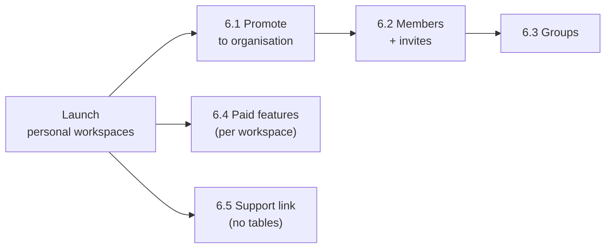

# PostScript Annotation App — Data Model

> **Companions:** [migration-plan.md](migration-plan.md) (§3 database work), [auth-spec.md](auth-spec.md) (`ensure_account`, sessions, roles), [data-protection.md](data-protection.md) (what each table holds and for how long), [architecture-baseline.md §4.3](architecture-baseline.md) (current schema).
> **Status:** draft, revised 2026-11-03: no staff role (`platform_role`, `admin_audit` removed), no tutorial flag, and the cutover creates Supabase Auth accounts because today's users are in Netlify Identity.

---

## 1. Principles

1. **The workspace is the tenant.** Each user gets a **personal workspace** on first sign-in. Anything that belongs to "the account" hangs off the workspace, not the user. Later, a personal workspace can be **promoted** to an organisation. That's an update to one row, not a data migration.
2. **Membership is a table, not a column.** `workspace_members(workspace_id, user_id, role)` from day one. Later on, many members per workspace, and many workspaces per user, need no schema change.
3. **No personal data outside Supabase Auth.** The email address and password hash live only in `auth.users`. Our tables hold ids, workspace roles, preferences and timestamps. No names, no copies of the email.
4. **Everything cascades from `auth.users`.** Deleting the Auth user removes every row about that person. Account deletion is one Admin API call.
5. **Server-only access.** RLS is on for every table with no policies. Only the server, with the secret key, reads or writes.
6. **Additive growth.** Future features add tables and enum values. They don't rename or reshape launch tables (§6).

---

## 2. Launch schema

```mermaid
erDiagram
  auth_users ||--|| users : "auth_id (cascade)"
  users ||--o{ workspace_members : "user_id (cascade)"
  workspaces ||--o{ workspace_members : "workspace_id (cascade)"
  users ||--o| workspaces : "personal_owner_id (cascade)"
  users ||--|| user_app_states : "user_id (cascade)"
  users ||--o{ session_policies : "user_id (cascade)"
  user_app_states }o--o| specialties : selected
  user_app_states }o--o| sub_specialties : selected
  user_app_states }o--o| illustrations : selected
  specialties ||--o{ specialty_sub_specialties : ""
  sub_specialties ||--o{ specialty_sub_specialties : ""
  sub_specialties ||--o{ sub_specialty_illustrations : ""
  illustrations ||--o{ sub_specialty_illustrations : ""

  users { uuid id PK; uuid auth_id UK; timestamptz created_at }
  workspaces { uuid id PK; workspace_kind kind; text name; uuid personal_owner_id UK; timestamptz created_at }
  workspace_members { uuid workspace_id PK; uuid user_id PK; workspace_role role; timestamptz created_at }
  user_app_states { uuid user_id PK; uuid selected_specialty_id; uuid selected_sub_specialty_id; uuid selected_illustration_id }
  session_policies { uuid session_id PK; uuid user_id; session_mode mode; timestamptz created_at; timestamptz last_seen_at; timestamptz recovery_verified_at }
  rate_limits { text key PK; timestamptz window_start PK; int count }
```

### 2.1 Enums

| Enum | Values at launch | Later |
|---|---|---|
| `workspace_kind` | `personal`, `organization` | — |
| `workspace_role` | `owner`, `member` | maybe `admin` (org admins who aren't billing owners) |
| `session_mode` | `personal`, `shared` | — |

`organization` exists from the start so promotion (§6.1) needs no `ALTER TYPE`. Nothing creates one at launch. There is **no `platform_role` enum**: this migration has no staff role, and a future admin project adds its own design.

---

## 3. Tables

### 3.1 Identity and tenancy

| Table | Columns and constraints |
|---|---|
| `users` | `id uuid pk default gen_random_uuid()`. `auth_id uuid not null unique references auth.users(id) on delete cascade`. `created_at timestamptz not null default now()`. |
| `workspaces` | `id uuid pk`. `kind workspace_kind not null default 'personal'`. `name text` (null for personal). `personal_owner_id uuid unique references users(id) on delete cascade`. `created_at`. **Checks:** `(kind = 'personal') = (personal_owner_id is not null)`; `kind = 'personal' or name is not null`. |
| `workspace_members` | `workspace_id uuid references workspaces(id) on delete cascade`. `user_id uuid references users(id) on delete cascade`. `role workspace_role not null`. `created_at`. **PK** `(workspace_id, user_id)`. Index on `user_id`. |

- `personal_owner_id` is unique, so a user has **at most one personal workspace**.
- **No unique constraint on `workspace_members.user_id`.** At launch each user has exactly one membership, because only `ensure_account` creates memberships. Leaving the constraint out means multi-workspace membership later needs no schema change.
- Personal workspaces have **no name**. The UI shows "Your workspace" or nothing at all.

### 3.2 App state

| Table | Columns and constraints |
|---|---|
| `user_app_states` | `user_id uuid pk references users(id) on delete cascade`. `selected_specialty_id`, `selected_sub_specialty_id`, `selected_illustration_id`: nullable FKs to the catalogue, **`on delete set null`**, so removing a catalogue item in a migration never breaks a user. No tutorial flag (dropped, not moved). |

App state is per **user**, not per workspace. It holds the user's own preferences, which stay the same whichever workspace they're in.

### 3.3 Catalogue

Kept from the current schema ([baseline §4.3](architecture-baseline.md)): `specialties`, `sub_specialties`, `specialty_sub_specialties`, `illustrations` (`name`, `src` = Cloudinary public ID, `default_illustration`, `illustration_aliases text[]`), `sub_specialty_illustrations`. Changes:
- Join tables get composite primary keys and an `ordering int` column where the catalogue needs ordering.
- **Read-only for the app.** Until a separate admin project ships, the catalogue changes only through reviewed SQL migrations in `supabase/migrations/`; Cloudinary uploads stay manual.
- `original_source_id` is dropped.
- **No per-tenant filter.** Every user sees every specialty. `organizations.available_specialties` goes away with `organizations`.

### 3.4 Sessions and abuse

| Table | Columns and constraints |
|---|---|
| `session_policies` | `session_id uuid pk` (Supabase JWT `session_id` claim). `user_id uuid not null references users(id) on delete cascade`. `mode session_mode not null`. `created_at`, `last_seen_at`. `recovery_verified_at timestamptz` (null unless the session came from a recovery link; set only by the `/auth/confirm` POST, cleared after the reset). Rules in [auth-spec §5](auth-spec.md). |
| `rate_limits` | `key text` (HMAC-hashed: e.g. `signin:email:<hash>`, `signin:ip:<hash>`, `signup:ip:<hash>`, `reset:email:<hash>`, `confirm:ip:<hash>`, `feedback:user:<id>`; limits in [auth-spec §6](auth-spec.md)). `window_start timestamptz`. `count int`. **PK** `(key, window_start)`. Rows older than 24 hours are purged. |

---

## 4. Functions

All are `security definer`, `set search_path = ''`, with `execute` granted to `service_role` only.

| Function | Does |
|---|---|
| `ensure_account(p_auth_id uuid) returns users` | Idempotent. If no `users` row exists for `p_auth_id`: insert the user, the personal workspace (`personal_owner_id` = user), the `owner` membership and the app state, in one transaction. If the user exists but has **no memberships**, create the personal workspace again. Returns the `users` row. Uses `on conflict do nothing` so two simultaneous calls are safe. |
| `export_account(p_auth_id uuid) returns jsonb` | Everything we hold about the person: email and auth timestamps from `auth.users` (never the password hash), workspaces + roles, app state, session policies (mode and timestamps). Backs "Download my data". |
| `purge_unconfirmed_signups()` | `delete from auth.users where email_confirmed_at is null and created_at < now() - interval '24 hours'`. Checked on staging (0.3): `auth.identities`, `auth.one_time_tokens`, `auth.sessions`, `auth.mfa_factors` and the other `auth.*` children reference `auth.users` with `on delete cascade` (refresh tokens and amr claims go too, via sessions). A live delete of an unconfirmed user with one identity and one token left 0 of each. |
| `purge_expired_sessions()` | Deletes `session_policies` rows past their absolute lifetime (8 h shared, 30 d personal) and the matching `auth.sessions` rows (refresh tokens cascade). |
| `purge_rate_limits()` | Deletes `rate_limits` rows older than 24 hours. |

pg_cron (1.6, already in `shared_preload_libraries` on hosted) is enabled by `create extension pg_cron` in a migration. `cron.schedule` works on free (checked on staging in 0.3). Schedules: `purge_rate_limits` hourly; the others nightly. The full schedule is in [data-protection §6](data-protection.md). The Supabase auth audit log is kept and **not** purged by us ([auth-spec §2](auth-spec.md)).

Account deletion is **not** an RPC. The server calls Admin API `deleteUser(auth_id)` and the cascades do the rest.

---

## 5. Invariants (tested)

1. Every `users` row has exactly one `user_app_states` row.
2. Every user has at least one membership (launch: exactly one, as `owner` of their personal workspace).
3. A personal workspace has exactly one member, its `personal_owner_id`, with role `owner`.
4. Deleting an `auth.users` row leaves no row in any public table that refers to that person.
5. No public table has a column holding an email address, name or IP address.
6. No staff scope creeps back in: CI greps `src/` and new migrations for `dm`, `platform_role`, `requireStaff`, `admin_audit`, `routes/(admin)` and `/admin` ([execution plan, Verification](migration-execution-plan.md)).

---

## 6. Expansion path (not built at launch)

Each stage adds tables or values. Launch rows keep working unchanged.



### 6.1 Promote a personal workspace to an organisation

- Owner action `promoteWorkspace {name}` → `update workspaces set kind = 'organization', name = $1, personal_owner_id = null where id = <active workspace> and kind = 'personal'`.
- Everything that belongs to the workspace (later: saved work, uploaded illustrations, feature entitlements) stays with it.
- The promoter no longer has a personal workspace, which is allowed. If they later leave the organisation and have no memberships left, `ensure_account` gives them a fresh personal workspace.
- Guards gain `requireWorkspaceRole` ([auth-spec §7.2](auth-spec.md)).

### 6.2 Members and invites

- `workspace_invites`: `id`, `workspace_id` (cascade), `email_normalised`, `role workspace_role`, `token_hash` (SHA-256 of 32 random bytes, base64url), `invited_by`, `expires_at` (7 days), `accepted_at`, `revoked_at`. Partial unique index on `(workspace_id, email_normalised)` where the invite is open.
- `accept_invite(auth_id, invite_id)` adds a `workspace_members` row to the invitee's **existing** account (or `ensure_account` first). It doesn't create a separate login.
- **Active workspace:** a signed `ps_workspace` cookie picks which membership `locals.profile` uses. It defaults to the most recent one. The hook checks the membership exists on every request.
- Rules carried over from the earlier spec: at least one owner per workspace, the last owner can't be demoted or removed, and the role comes from an allow-list.
- **Personal data impact:** owners see member email addresses. Revisit [data-protection §9](data-protection.md) before building.

### 6.3 Groups inside an organisation

- `groups`: `id`, `workspace_id` (cascade), `name`, `created_at`, `unique (workspace_id, name)`, `unique (id, workspace_id)`.
- `group_members`: `group_id`, `workspace_id`, `user_id`, **PK** `(group_id, user_id)`. **Composite FKs** `(group_id, workspace_id) → groups(id, workspace_id)` and `(workspace_id, user_id) → workspace_members(workspace_id, user_id)`, both `on delete cascade`. The database itself then guarantees a group member is a member of the same organisation, and removing someone from the org removes them from its groups.
- Only `kind = 'organization'` workspaces can have groups (checked in the RPC).

### 6.4 Paid features (e.g. 3D organ models)

- `feature_key` enum (e.g. `organ_3d`). `workspace_features`: `workspace_id` (cascade), `feature`, `source` (`stripe` | `grant`), `starts_at`, `ends_at`, `revoked_at`.
- `workspace_has_feature(workspace_id, feature) returns bool`, used by `requireFeature`.
- Features attach to the **workspace**, so a personal user who buys one keeps it after promoting to an organisation.
- New asset types (e.g. a `models_3d` table) link to the catalogue and carry a `required_feature`. Free illustrations stay free.
- Billing tables (`billing_customers`, a Stripe subscription mirror, `stripe_events`) get designed in a new billing plan at that point ([migration-plan §8](migration-plan.md)).

### 6.5 "Support this project"

An external link (e.g. a Stripe Payment Link, Ko-fi or GitHub Sponsors). **No tables, no webhook, no stored supporter data.** If we ever want to thank supporters in the app, that's a deliberate later decision with its own data-protection review.

### 6.6 Rules for launch code that keep this cheap

- `locals.profile` always carries `workspaceId` and `workspaceRole`, even though there's only one workspace per user.
- Anything new that belongs to the account gets `workspace_id`, not `user_id`. Preferences stay on the user.
- Don't write code that assumes a user has exactly one membership. Pick the active one.

---

## 7. Cutover data migration (current → target)

Today's users sign in with **Netlify Identity**, and production `auth.users` is empty, so the cutover first creates Supabase Auth accounts, then reshapes the data. **The reshape is the schema migrations from execution plan 1.4** (`supabase/migrations/20261103160000_*` to `20261103160500_*`, decided 2026-11-03), applied with `supabase db push` after the Stripe cancellation step ([migration-plan §5, Phase 3](migration-plan.md); execution plan 3.6–3.7). They do nothing to empty tables, so the same files run on local, staging and production. Each file runs in its own transaction (checked locally: a failing statement rolls back its whole file). A failure in a later file leaves the earlier files applied, so the runbook restores the rollback dump in that case. Rehearse on a restored copy in staging first.

**Before the migration (script, not SQL):** `scripts/cutover/create-auth-users.ts` creates a confirmed Supabase Auth account with **no password** for each kept user (execution plan G6: `users` rows whose `netlify_id` matches a confirmed Netlify Identity user) and sets `users.auth_id`. Idempotent, safe to re-run. The new accounts carry no `app_metadata` or `user_metadata`. Users set a password through "Forgot password" ([auth-spec §8](auth-spec.md)).

Then the migrations (file in brackets):

1. **Create** the new enums and tables (`_enums`, `_tenancy_and_sessions`). Functions come in execution plan 1.5.
2. **Remove accounts that aren't kept:** delete `users` rows with no `auth_id` (not matched under G6), with their app state (`_reshape_users`).
3. **No role mapping.** Every legacy `user`, `admin` and `dm` becomes a plain user; the legacy `role` column is simply dropped.
4. **Personal workspaces:** for each remaining user, insert a personal workspace and an `owner` membership (`_reshape_users`).
5. **App state:** keep one `user_app_states` row per user (the latest `updated_at` if there are duplicates), make `user_id` the PK. Create a default row for anyone missing one. `show_tutorial` is not carried over (`_reshape_users`).
6. **Drop personal and billing data:** drop `users.email`, `first_name`, `last_name`, `role`, `show_tutorial`, `team_id`, `netlify_id`, `original_source_id`, `updated_at`; `auth_id` becomes `not null unique` (its FK to `auth.users` with `on delete cascade` is kept from the baseline) (`_reshape_users`). Then drop **every legacy table** (`_drop_legacy_tables`, decided 2026-11-03): the nine `*_raw` Fauna dumps, `migration_failures`, `organizations`, `teams`, `restricted_organization_specialties`, `products`, `product_prices`, `subscription_plans`, `subscription_plan_products`.
7. **Verify invariants** with SQL assertions: §5.1–§5.3 at the end of `_reshape_users`, §5.5 at the end of `_drop_legacy_tables`, RLS on everywhere and no `anon`/`authenticated` privileges at the end of `_lock_down`. Any failure rolls back that file.

Tested 2026-11-03 on the local stack with legacy-shaped fixtures (a kept user with a team and duplicate app states, a kept `dm` user with none, an unkept user): the unkept user was removed, the latest app state kept, defaults and personal workspaces created.

**Before the migration,** take one encrypted `pg_dump` as a rollback point. Delete it once the old site is retired (one or two weeks after cutover, [data-protection §6](data-protection.md)).

---

## 8. Open questions

1. **App state per workspace?** Per user is assumed. Revisit if organisations want a shared default specialty.
2. **Ordering in the catalogue:** does the catalogue need manual ordering of specialties as well as sub-specialties, or is alphabetical enough? (Set by SQL migration either way.)
