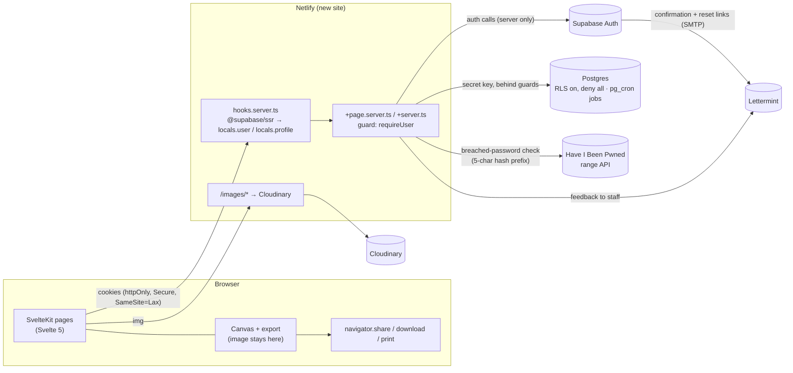

# PostScript Annotation App — SvelteKit + Supabase Migration Plan

> **Companions:** [architecture-baseline.md](architecture-baseline.md) (risk IDs like S4, defects in §8), [auth-spec.md](auth-spec.md), [data-model.md](data-model.md), [data-protection.md](data-protection.md).
> **Branch:** `migration-sveltekit` → `staging` → `main`.
> **Status:** draft, revised 2026-11-03. The app is **free, individual-first, email + password sign-up**. Billing, seats, trials, team management and staff (admin) controls are out of the launch scope. The ordered steps are in [migration-execution-plan.md](migration-execution-plan.md).

---

## 1. Decisions

| Topic | Decision | Notes |
|---|---|---|
| Product model | **Free for everyone.** Anyone with an email address can sign up and use the whole app. No subscriptions, trials, seats or locked state. | A "support this project" link and paid features come later (§8). |
| Account model | **Individual by default.** Each user gets a **personal workspace**. Workspaces can later be **promoted to organisations** with members and groups, without a data migration ([data-model.md](data-model.md)). | Org features are designed now and built later. |
| Data minimisation | **Hold as little personal data as possible.** Only an email address and password hash (in Supabase Auth) and the technical data needed to run sessions. No names, org details, country, payment data, analytics or patient data. | [data-protection.md](data-protection.md) |
| Sharing | **On the device only.** Native share sheet (`navigator.share` with a file), download, print. **No server-side email of images.** | Annotations and images never reach our servers (removes S7 and S19). |
| Backend vendor | **Supabase** (Auth + Postgres), project in **eu-west-2 (London)**. | Fauna is removed completely. |
| Compliance target | **UK/EU GDPR**, initial users in NZ + UK. | London region covers both. |
| Frontend | **SvelteKit (Svelte 5) + Vite + TypeScript**, `@sveltejs/adapter-netlify` | Replaces Svelte 3, Rollup, Babel/IE11, svelte-spa-router, hash routing. |
| Backend | **SvelteKit server code** (`+page.server.ts`, `+server.ts`, form actions). Netlify Functions are retired. Scheduled jobs run as **pg_cron** in Postgres. | One codebase, shared guards, typed DTOs. No Netlify Scheduled Functions needed. |
| Auth model | **Server-side only, httpOnly cookies** via `@supabase/ssr` in `hooks.server.ts`. **Email + password**; the email is the username. Confirm email on, password reset by email ([auth-spec.md](auth-spec.md)). | No Supabase client in the browser. RLS is on as a backstop. No magic links or sign-in codes. |
| Password policy | NIST SP 800-63B-4 / NCSC: at least 15 characters, up to 72 bytes, no composition rules or expiry, NFKC-normalised, checked against breached passwords with the HIBP range API ([auth-spec §1](auth-spec.md)). | Supabase's own leaked-password check is Pro only. |
| Email provider | **Lettermint** (EU), as Supabase custom SMTP and for feedback. Free tier: 300 emails a month (§9). | Sign-in sends no email. |
| Staff / admin | **No staff role in this migration.** No `dm`, `platform_role`, `requireStaff`, `admin_audit` or `/admin/**` routes; every legacy user becomes a plain user. The catalogue changes only through SQL migrations until a separate admin project ships. | `/admin` is a plain 404. |
| Stripe | **Removed from the new app.** Existing subscriptions are set to **cancel at period end** at cutover (§5, Phase 3). | No Stripe keys, webhook or Stripe.js in the new site. |
| Existing orgs | **Split into individual accounts** at cutover. Org, team, name and Stripe data are deleted. | [data-model.md §7](data-model.md) |
| Hot fixes | **None on production.** Every fix lands in this migration. | Production (`main`) stays unchanged until cutover. |
| Deployment | **New, separate Netlify site** during the migration: staging `https://staging.app.postscriptmedical.com`, production `https://app.postscriptmedical.com`. | Old site keeps serving `main`. Swap domains at cutover. |
| Service tiers | **Free tiers** for Supabase, Netlify and the rest. | Constraints and workarounds in §9. |
| Team | Two people (you + Claude). We do everything, tests included. | Keeps the plan lean. |

---

## 2. Target architecture



### 2.1 Source layout

```
src/
├── hooks.server.ts            # per-request Supabase SSR client, claims, session policy, profile, security headers
├── app.d.ts                   # App.Locals { user, profile, supabase }
├── lib/
│   ├── server/                # never importable from the browser (SvelteKit enforces this)
│   │   ├── supabase.ts        # createSsrClient(event), adminClient (secret key)
│   │   ├── guards.ts          # requireUser (future: requireWorkspaceRole, requireFeature)
│   │   ├── errors.ts          # port of functions/utils/error-handler.js (codes + request IDs)
│   │   ├── validation.ts      # zod schemas for every action / endpoint input
│   │   ├── password.ts        # NFKC, length, HIBP range check + bundled-list fallback
│   │   ├── rate-limit.ts      # Postgres-backed counter, HMAC-hashed keys
│   │   ├── email.ts           # feedback email only, HTML-escaped (Lettermint SMTP)
│   │   └── repos/             # one module per aggregate: accounts, sessions, catalogue
│   ├── sketchpad/             # ported canvas engine
│   ├── share/                 # client-side export: Web Share, download, print
│   ├── components/            # design system (ported Ps* components, prefix dropped)
│   └── types/                 # generated DB types (supabase gen types) + DTOs
└── routes/
    ├── (public)/              # / (sign-in), /sign-up, /forgot-password, /auth/confirm, /reset-password, /logout (privacy and terms: links to the marketing site)
    └── (app)/                 # +layout.server.ts → requireUser
        ├── annotate/
        └── account/           # email, change password, sessions, export my data, delete my account
supabase/
├── config.toml
├── templates/                 # auth email templates
├── migrations/                # the schema, versioned (data-model.md)
└── seed.sql                   # generated: staging catalogue + two test users, local only
scripts/                       # generate-seed.sh; cutover/ scripts later
legacy/                        # old code, git-ignored, local reference only, deleted before cutover
```

Gone compared with earlier drafts: `/sign-in/code`, `/onboarding`, `/invite/[token]`, `/manage-team`, `/inactive-account`, `/billing*`, `/api/stripe/webhook`, and the whole `(admin)` group (`/admin/**`).

### 2.2 Authentication and authorization

Specified in [auth-spec.md](auth-spec.md):
- **Email + password:** `/sign-up` (confirm email on), sign-in at `/`, `/forgot-password` → scanner-safe `/auth/confirm` → `/reset-password`, change password on `/account`. Emailed links use `{{ .TokenHash }}` and are verified only on POST, so email scanners can't use them up.
- **Accounts:** the first verified sign-in creates the user, their personal workspace and app state (`ensure_account`).
- **Sessions:** personal (30 days) or shared device (8 hours), enforced by the app through `session_policies`.
- **Roles:** no platform roles; every account is a plain user. Workspace roles (`owner` / `member`) exist in the schema for later.
- **Guards and matrix:** the guard set and the role × route matrix the authorization tests are built from.

---

## 3. Database work (Supabase CLI migrations)

The target schema, invariants and expansion path are in [data-model.md](data-model.md). The work:

1. **Capture the current schema:** done in step 0.1 (`supabase db pull` from staging → baseline migration; RLS and grants recorded in [supabase-baseline-notes.md](supabase-baseline-notes.md), S20).
2. **New tables:** `workspaces`, `workspace_members`, `session_policies` (with `recovery_verified_at`), `rate_limits`. New enums `workspace_kind`, `workspace_role`, `session_mode`.
3. **Reshape `users`:** keep `id`, `auth_id` (unique, FK to `auth.users` on delete cascade). **Drop** `email`, `first_name`, `last_name`, `role`, `show_tutorial`, `team_id`, `netlify_id`, `original_source_id`.
4. **Reshape `user_app_states`:** `user_id` becomes the primary key (FK cascade). The tutorial flag is not kept.
5. **Cutover data migration** (data-model §7): Supabase Auth accounts for the kept users (production `auth.users` starts empty), one personal workspace per user, then drop `organizations` and `teams`.
6. **RPCs** (`security definer`, callable only by the service role): `ensure_account(auth_id)`, `export_account(auth_id)`.
7. **Scheduled jobs (pg_cron):** purge unconfirmed sign-ups, expired session policies, old rate-limit rows (data-protection §6). The Supabase auth audit log is kept and not purged by us.
8. **RLS:** enable on every public table. No policies for `anon`/`authenticated`. The server's secret key bypasses RLS, so this only guards against accidental key exposure.
9. **Generated types:** `supabase gen types typescript` → `src/lib/types/db.ts`, regenerated in CI.

---

## 4. Old → new mapping

Every legacy function is either **rewritten behind a guard** or **deleted**. None is copied over unchanged.

| Legacy function | New home | Guard | Fixes |
|---|---|---|---|
| `auth-login` | `/` (sign-in) with password, and `/sign-up` ([auth-spec §4.1](auth-spec.md)) | — (rate-limited) | S9, S13, S18 |
| `auth-session`, `auth-refresh` | `hooks.server.ts` | — | S9, S13 |
| `auth-logout` | `/logout` action | user | S10 |
| `auth-password-reset-request`, `auth-password-reset` | `/forgot-password` + `/auth/confirm` + `/reset-password` (recovery marker, [auth-spec §4.1](auth-spec.md)) | — (rate-limited) | S14, S18 |
| `accept-team-invitation`, `invite-team-member` | **delete**. Invites return with organisations ([data-model §6](data-model.md)). | — | S4, S12 |
| `get-protected-content` | `(app)/+layout.server.ts` (profile) + catalogue loader (cached) | user | perf §6.1 |
| `update-app-state`, `update-chosen-specialty` | `annotate/+page.server.ts` actions, **by id** | user, own row | §8 |
| `send-annotation-email` | **delete**. Replaced by client-side share (`lib/share`). | — | S7, S19 |
| `send-feedback-email` | feedback action | user, rate-limited, escaped | S16 |
| `get-management-data`, `delete-team-member`, `update-team-member` 💀, `update-team-properties` 💀 | **delete** (no teams at launch) | — | S8, S11 |
| `get-organizations`, `invite-organization`, `delete-organization` | **deleted** in 0.4 (no orgs, no admin) | — | S2, S5, S8 |
| `get-specialties` | catalogue repo (Postgres, read-only) | user | — |
| `get-illustrations*` 💀, `update-illustration-details`, `update-sub-specialty-details` 💀 | **deleted** in 0.4. The catalogue changes only through SQL migrations in `supabase/migrations/` until admin controls exist. | — | S11 |
| `identity-signup` 💀 | **delete** | — | S11 |
| `create-manage-link`, `stripe-customer-portal`, `stripe-checkout`, `get-subscription-plans`, `handle-subscription-change`, `create-invited-account` | **delete** (no billing) | — | S3, S6 |
| `functions/methods/netlify-*`, `create-organization.js`, `update-org-subscription-*` | **delete** | — | S11 |

Screens deleted with them: `DrFalk`, `SignUp*`, `ConfirmSignUp`, `SignUpPlans`, `Success`, `InactiveAccount`, `ManageTeam`, `AcceptTeamInvitation`, every `Admin*` screen, `components/admin/*`, `InviteNewOrgModal`, `EditSubSpecialtyModal`, `ShareModal`'s email tab. `SignInForm`, `CredentialsForm`, `ForgotPasswordModal` and `ResetPassword` are ported to the new routes (execution plan 1.10).

---

## 5. Phases

Each phase ends with a deploy to the new Netlify site and a green CI run. The numbered steps, checks and decision gates are in [migration-execution-plan.md](migration-execution-plan.md); this section is the summary.

### Phase 0 — Groundwork ✅ (steps 0.1–0.8)
- [x] Supabase CLI: `supabase init`, linked to **staging**, `db pull` baseline; RLS, grants and Auth settings recorded ([supabase-baseline-notes.md](supabase-baseline-notes.md)). Production is not linked and stays untouched until cutover.
- [x] Free-tier checks on staging: pg_cron, cascades from `auth.users`, `config push` coverage, `amr` after recovery, the 72-byte password limit, `minimum_password_length = 15`, leaked-password protection (Pro only).
- [x] Legacy code moved to `legacy/` (git-ignored, local only); all admin code deleted.
- [x] The second Netlify site deploys the `staging` branch automatically (and no other branch); `migration-sveltekit` reaches it once `staging` is updated.
- [x] Lettermint as Supabase custom SMTP on staging (email rate limit 5/hour).
- [x] Local stack (`supabase start`) + `seed.sql`: the catalogue dumped from staging plus two test users (`scripts/generate-seed.sh`).
- [x] Docs updated for email + password, no staff role, Lettermint.

### Phase 1 — Scaffold, auth, account
- [ ] `sv create`: SvelteKit, Svelte 5, TypeScript, Vite, adapter-netlify, ESLint 9 flat config, Prettier 3, Husky 9, Vitest.
- [ ] Remove dead deps: `faunadb`, `gotrue-js`, `node-fetch`, `mdsvex`, `svench`, `stripe`, `postmark`, Rollup/Babel/core-js/whatwg-fetch, `svelte-spa-router`. Move CLIs to devDeps.
- [ ] `app.html`: **no third-party scripts or styles at all**. No polyfill.io (S1), no Stripe.js, GSAP from npm, Montserrat **self-hosted** (Google Fonts would send every visitor's IP to Google).
- [ ] Security headers in `hooks.server.ts`: CSP via `kit.csp` (nonce mode, `connect-src 'self'`), HSTS, `X-Content-Type-Options`, `Referrer-Policy`, `Permissions-Policy` (S9). CORS: same-origin only (S15).
- [ ] `lib/server/*`: supabase clients, guard, errors, validation, password policy, rate limit, logging.
- [ ] Schema migrations for data-model §3, `ensure_account`, pg_cron jobs.
- [ ] Auth flows from [auth-spec.md](auth-spec.md) §4–§6 (sign-up, sign-in, forgot/reset password), plus Supabase config and email templates in the repo (§2).
- [ ] `/account`: change password, sessions, sign out everywhere, export my data, delete my account.
- [ ] Design system (the `Ps*` components without the prefix); privacy notice and terms of use drafted for the marketing site, which the app links to (data-protection §8).
- [ ] Netlify redirect `/images/*` → Cloudinary kept in `netlify.toml`.

### Phase 2 — Clinician journey
- [ ] Port `sketchpad/` and the undo store. Svelte 5 still compiles Svelte 3/4 syntax, so port first and convert to runes after the E2E tests pass.
- [ ] Fix `dpr` (`Math.min(devicePixelRatio, 2)`). Drop the `msSaveBlob` and IE branches.
- [ ] Catalogue loader: **every specialty is available to every user** (no `available_specialties` filter). Read-only. Load once and cache (`setHeaders` private max-age), not on every navigation.
- [ ] Choose specialty / illustration → actions by id.
- [ ] Share, all on the client (`lib/share`): `navigator.canShare({ files })` → `navigator.share` with the JPEG. Otherwise download. Print through `window.print()`. No network request carries the image.
- [ ] Feedback modal → action (staff email through Lettermint, rate-limited, escaped).

### Phase 3 — Hardening + cutover
(The earlier "Staff (DM) catalogue" phase is removed: no `/admin/**`, no `admin_audit`. Catalogue changes go through SQL migrations; Cloudinary uploads stay manual.)
- [ ] Authz matrix tests green (§6). Run `/security-review` and `/code-review` on the branch.
- [ ] Structured logs with user ids only: no emails, IPs or passwords (S17). Generic client errors only.
- [ ] Nightly encrypted backups and `docs/operations.md`; delete `legacy/`.
- [ ] Cutover runbook, then a rehearsal on a production copy restored into staging; merge to `staging` and run the smoke suite (`npm run test:smoke`) against the staging site, including WebKit/iPad.
- [ ] **Data check:** the user count from Netlify Identity (execution plan G2) and a few known accounts, before running the cutover migration.
- [ ] **Stripe:** set every active subscription to `cancel_at_period_end` (script or dashboard), disable the old webhook endpoint, and remove Stripe keys from both Netlify sites.
- [ ] **Accounts:** production `auth.users` is empty (today's users sign in with Netlify Identity), so a script creates a confirmed Supabase Auth account, with no password, for each kept user (execution plan G6) and sets `users.auth_id`. Then the cutover data migration (data-model §7). Rotate Supabase API keys and move production to asymmetric JWT keys.
- [ ] Merge `staging` → `main`. Point `app.postscriptmedical.com` at the new site and set Supabase `SITE_URL` + redirect URLs. Keep the old site available for rollback for one or two weeks.
- [ ] **Cutover email** to each kept user through Lettermint: the app is free, their account and settings have moved, and they set a new password with "Forgot password" (old passwords stay in Netlify Identity and can't be carried over). Subscriptions won't renew. Batch it if the email budget needs it (§9).

The cutover runbook is written in execution plan step 3.5 (§10).

---

## 6. Testing strategy

| Layer | Tool | Runs against | What |
|---|---|---|---|
| Unit | Vitest | Node | Guards, validation schemas, password policy (NFKC, 15 characters, 72 bytes, mocked HIBP and its fallback), rate limiter, sketchpad helpers, filters/sorters, share fallbacks. |
| Integration / authz | Vitest | **Local Supabase** (`supabase start` in CI) | Every action/endpoint × caller (`anon`, `user`, other `user`). Expect allow/deny. `ensure_account` idempotency, cascade on account deletion, pg_cron purge functions, `/reset-password` refusing anything but a fresh recovery session. |
| E2E | Playwright | `vite preview` locally / in CI; a smoke suite by hand against the staging site | Sign-up → confirm link (local Mailpit) → account created; sign-in with password; forgot → reset password; annotate + download/print; account export and deletion; `/admin` returns 404. Chromium + **WebKit**. |
| Visual | Percy | E2E run | Snapshots kept in the specs. No baseline in this migration; whether to use Percy is reassessed later. |

CI (GitHub Actions): lint → typecheck → unit → integration (local Supabase) → build → E2E. Percy on PRs to `staging`/`main`.

---

## 7. Fix coverage (baseline §7 / §8 → where)

| Item | Fixed in |
|---|---|
| S1 polyfill.io | Phase 1 (`app.html`, no third-party scripts) |
| S2, S3, S5, S6, S8 (org admin, Stripe, coupon accounts, cross-tenant deletes) | **Removed**: the features are gone at launch |
| S4, S12 (role escalation, seats) | **Removed**: no team management and no platform roles at all |
| S7, S19 (email relay, health data by email) | **Removed**: sharing happens on the device |
| S9, S10, S13, S14, S15 (tokens, logout, password reset, CORS) | Phase 1. S14: `/reset-password` needs our own recovery marker (`session_policies.recovery_verified_at`, 15 min) |
| S11 (Fauna write functions) | Deleted (admin functions in 0.4; the rest moved to the local, untracked `legacy/` and removed in Phase 3) |
| S16 (feedback HTML injection) | Phase 2 |
| S17 (leaks/logging) | Phase 1 errors module, Phase 3 review |
| S18 (rate limiting) | Phase 1 module, applied per phase |
| S20 (RLS) | §3.8 |
| §8 defects | Phase 1 (session, errors, stay-logged-in), Phase 2 (`dpr`, app state by id, portal store removed). Invite bounce and webhook defects go away with their features. |

---

## 8. Later: support, organisations, paid features

Not built in this migration. The launch design keeps each one additive:

| Feature | Shape | What we'd store |
|---|---|---|
| **"Support this project"** | A link from the app to an external platform (e.g. a Stripe Payment Link, Ko-fi, GitHub Sponsors). | **Nothing.** The platform is the controller for payment data. |
| **Organisation accounts** | Promote a personal workspace → organisation; invites, members, groups ([data-model §6](data-model.md)). | Member emails visible to owners; revisit data-protection §9. |
| **Paid features** (e.g. 3D photo-realistic organ models) | Feature entitlements on the workspace, a `requireFeature` guard, Stripe for payment. | Billing customer link and subscription mirror; a new billing plan and DPIA review at that point. |

Lessons to carry into the future billing design from the dropped billing plan: Stripe as the source of truth with one idempotent sync function (never match customers by email), prices by lookup key, org and customer always derived from the session, webhook returns 500 on failure so Stripe retries.

---

## 9. Free-tier constraints

| Service | Constraint | What we do |
|---|---|---|
| Supabase | No session time-box / inactivity settings | The app enforces both session modes ([auth-spec §5](auth-spec.md)). |
| Supabase | **No backups** | Nightly `pg_dump` from a scheduled GitHub Action, encrypted (`age`), kept as an artifact for **7 days**. Backups hold email addresses, so short retention matters (data-protection §6). |
| Supabase | Projects pause after about a week without activity | Production is used daily. Staging may pause; unpause before test runs, or add a weekly ping. |
| Supabase | The built-in SMTP sends only a few emails an hour to team members | Lettermint as custom SMTP. Project email rate limit: 5/hour on staging; production set at cutover, well under the monthly budget. |
| Supabase | Leaked-password protection is Pro only | Our own HIBP range check (auth-spec §2). |
| Email | **Lettermint Free: 300 emails a month**, one project, one sending domain, so staging and production share the quota. No daily cap. Retention 28 days, fixed. | Sign-in sends no email. Only sign-up confirmations, password resets, feedback and the one-off cutover announcement use it ([execution plan, "Email budget"](migration-execution-plan.md)). The cutover month carries two emails per existing user; batch the announcement if needed. |
| Netlify | SSR means every page load is a function invocation, counted against the plan's limit. Function region selection may not be available on free. | Cache the catalogue, keep `/annotate` client-heavy after first load. Check the account's current plan limits. Latency to London is the only cost of a US function region. |
| Cloudinary | Bandwidth/transformation credits | Unchanged from today. |

---

## 10. Docs still to write

- **Cutover runbook:** the exact Phase 3 steps in order, with commands, checks and rollback (execution plan 3.5).
- **Operations:** backups and restore drill, pg_cron job list, logs and alerts, staging pause handling, monthly Lettermint usage, changing the catalogue with a SQL migration (execution plan 3.3).

---

## 11. Open questions

1. ~~**Auth email provider.**~~ **Closed:** Lettermint (EU, DPA signed, free 300/month). With passwords, sign-in sends no email.
2. ~~**`admin` role.**~~ **Closed:** there is no staff role in this migration. Every legacy `user`, `admin` and `dm` becomes a plain user.
3. ~~**Domain.**~~ **Closed:** staging `https://staging.app.postscriptmedical.com`, production `https://app.postscriptmedical.com`. Sender `no-reply@postscriptmedical.com` (SPF/DKIM verified in Lettermint).
4. **Existing user count** (execution plan G2): still open. Production `public.users` has 207 rows, but the real accounts are in Netlify Identity, so count from there. Above ~120 kept users, the cutover announcement is sent in batches.
5. **Controller identity:** which legal entity is the data controller named in the privacy notice (data-protection §8)? (G3)
