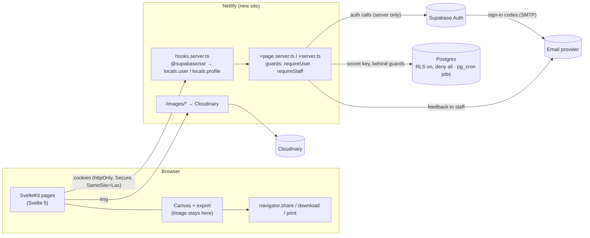

# PostScript Annotation App — SvelteKit + Supabase Migration Plan

> **Companions:** [architecture-baseline.md](architecture-baseline.md) (risk IDs like S4, defects in §8), [auth-spec.md](auth-spec.md), [data-model.md](data-model.md), [data-protection.md](data-protection.md).
> **Branch:** `migration-sveltekit` → `staging` → `main`.
> **Status:** draft, revised 2026-10-21. The app is now **free, individual-first, email-only sign-up**. Billing, seats, trials and team management are out of the launch scope.

---

## 1. Decisions

| Topic | Decision | Notes |
|---|---|---|
| Product model | **Free for everyone.** Anyone with an email address can sign up and use the whole app. No subscriptions, trials, seats or locked state. | A "support this project" link and paid features come later (§8). |
| Account model | **Individual by default.** Each user gets a **personal workspace**. Workspaces can later be **promoted to organisations** with members and groups, without a data migration ([data-model.md](data-model.md)). | Org features are designed now and built later. |
| Data minimisation | **Hold as little personal data as possible.** Only an email address (in Supabase Auth) and the technical data needed to run sessions. No names, org details, country, payment data, analytics or patient data. | [data-protection.md](data-protection.md) |
| Sharing | **On the device only.** Native share sheet (`navigator.share` with a file), download, print. **No server-side email of images.** | Annotations and images never reach our servers (removes S7 and S19). |
| Backend vendor | **Supabase** (Auth + Postgres), project in **eu-west-2 (London)**. | Fauna is removed completely. |
| Compliance target | **UK/EU GDPR**, initial users in NZ + UK. | London region covers both. |
| Frontend | **SvelteKit (Svelte 5) + Vite + TypeScript**, `@sveltejs/adapter-netlify` | Replaces Svelte 3, Rollup, Babel/IE11, svelte-spa-router, hash routing. |
| Backend | **SvelteKit server code** (`+page.server.ts`, `+server.ts`, form actions). Netlify Functions are retired. Scheduled jobs run as **pg_cron** in Postgres. | One codebase, shared guards, typed DTOs. No Netlify Scheduled Functions needed. |
| Auth model | **Server-side only, httpOnly cookies** via `@supabase/ssr` in `hooks.server.ts`. Email-only, passwordless ([auth-spec.md](auth-spec.md)). | No Supabase client in the browser. RLS is on as a backstop. |
| Stripe | **Removed from the new app.** Existing subscriptions are set to **cancel at period end** at cutover (§5, Phase 4). | No Stripe keys, webhook or Stripe.js in the new site. |
| Existing orgs | **Split into individual accounts** at cutover. Org, team, name and Stripe data are deleted. | [data-model.md §7](data-model.md) |
| Hot fixes | **None on production.** Every fix lands in this migration. | Production (`main`) stays unchanged until cutover. |
| Deployment | **New, separate Netlify site** during the migration. | Old site keeps serving `main`. Swap domains at cutover. |
| Service tiers | **Free tiers** for Supabase, Netlify and the rest. | Constraints and workarounds in §9. |
| Team | Two people (you + Claude). We do everything, tests included. | Keeps the plan lean. |

---

## 2. Target architecture



### 2.1 Source layout

```
src/
├── hooks.server.ts            # per-request Supabase SSR client, claims, session policy, profile, security headers
├── app.d.ts                   # App.Locals { user, profile, supabase }
├── lib/
│   ├── server/                # never importable from the browser (SvelteKit enforces this)
│   │   ├── supabase.ts        # createSsrClient(event), adminClient (secret key)
│   │   ├── guards.ts          # requireUser, requireStaff (future: requireWorkspaceRole, requireFeature)
│   │   ├── errors.ts          # port of functions/utils/error-handler.js (codes + request IDs)
│   │   ├── validation.ts      # zod schemas for every action / endpoint input
│   │   ├── rate-limit.ts      # Postgres-backed counter, HMAC-hashed keys
│   │   ├── email.ts           # feedback email only, HTML-escaped
│   │   └── repos/             # one module per aggregate: accounts, sessions, catalogue
│   ├── sketchpad/             # ported canvas engine
│   ├── share/                 # client-side export: Web Share, download, print
│   ├── components/            # Ps* design system
│   └── types/                 # generated DB types (supabase gen types) + DTOs
└── routes/
    ├── (public)/              # /sign-in, /sign-in/code, /auth/confirm, /logout, /privacy, /terms
    ├── (app)/                 # +layout.server.ts → requireUser
    │   ├── annotate/
    │   └── account/           # email, sessions, export my data, delete my account
    └── (admin)/admin/         # +layout.server.ts → requireStaff
        ├── specialties/
        ├── sub-specialties/
        └── illustrations/
supabase/
├── config.toml
├── templates/                 # auth email templates
├── migrations/                # the schema, versioned (data-model.md)
└── seed.sql                   # catalogue + test users for local dev
legacy/                        # old src/ and functions/, read-only reference, deleted before cutover
```

Gone compared with the previous draft: `/sign-up` (merged into `/sign-in`), `/onboarding`, `/invite/[token]`, `/manage-team`, `/inactive-account`, `/billing*`, `/api/stripe/webhook`, `admin/organizations`.

### 2.2 Authentication and authorization

Specified in [auth-spec.md](auth-spec.md):
- **Email only:** one form for sign-in and sign-up. Magic link + 6-digit code, with a confirm-button page so email scanners can't use up the link.
- **Accounts:** first successful sign-in creates the user, their personal workspace and app state (`ensure_account`).
- **Sessions:** personal (30 days) or shared device (8 hours), enforced by the app through `session_policies`.
- **Roles:** platform role `user` / `dm` (staff). Workspace roles (`owner` / `member`) exist in the schema for later.
- **Guards and matrix:** the guard set and the role × route matrix the authorization tests are built from.

---

## 3. Database work (Supabase CLI migrations)

The target schema, invariants and expansion path are in [data-model.md](data-model.md). The work:

1. **Capture the current schema:** `supabase db pull` from the eu-west-2 project → baseline migration. Also export current RLS policies (S20).
2. **New tables:** `workspaces`, `workspace_members`, `session_policies`, `rate_limits`, `admin_audit`. New enums `platform_role`, `workspace_kind`, `workspace_role`, `session_mode`.
3. **Reshape `users`:** keep `id`, `auth_id` (unique, FK to `auth.users` on delete cascade). Add `platform_role`. **Drop** `email`, `first_name`, `last_name`, `role`, `team_id`, `netlify_id`, `original_source_id`.
4. **Reshape `user_app_states`:** `user_id` becomes the primary key (FK cascade). Move `show_tutorial` here from `users`.
5. **Cutover data migration** (data-model §7): one personal workspace per existing user, role mapping, then drop `organizations` and `teams`.
6. **RPCs** (`security definer`, callable only by the service role): `ensure_account(auth_id)`, `export_account(auth_id)`.
7. **Scheduled jobs (pg_cron):** purge unconfirmed sign-ups, expired session policies, old rate-limit rows, auth audit entries (data-protection §6).
8. **RLS:** enable on every public table. No policies for `anon`/`authenticated`. The server's secret key bypasses RLS, so this only guards against accidental key exposure.
9. **Generated types:** `supabase gen types typescript` → `src/lib/types/db.ts`, regenerated in CI.

---

## 4. Old → new mapping

Every legacy function is either **rewritten behind a guard** or **deleted**. None is copied over unchanged.

| Legacy function | New home | Guard | Fixes |
|---|---|---|---|
| `auth-login` | `/sign-in` + `/sign-in/code` ([auth-spec §4.1](auth-spec.md)) | — (rate-limited) | S9, S13, S18 |
| `auth-session`, `auth-refresh` | `hooks.server.ts` | — | S9, S13 |
| `auth-logout` | `/logout` action | user | S10 |
| `auth-password-reset-request`, `auth-password-reset` | **delete** (no passwords) | — | S14 |
| `accept-team-invitation`, `invite-team-member` | **delete**. Invites return with organisations ([data-model §6](data-model.md)). | — | S4, S12 |
| `get-protected-content` | `(app)/+layout.server.ts` (profile) + catalogue loader (cached) | user | perf §6.1 |
| `update-app-state`, `update-chosen-specialty` | `annotate/+page.server.ts` actions, **by id** | user, own row | §8 |
| `send-annotation-email` | **delete**. Replaced by client-side share (`lib/share`). | — | S7, S19 |
| `send-feedback-email` | feedback action | user, rate-limited, escaped | S16 |
| `get-management-data`, `delete-team-member`, `update-team-member` 💀, `update-team-properties` 💀 | **delete** (no teams at launch) | — | S8, S11 |
| `get-organizations`, `invite-organization`, `delete-organization` | **delete** (no orgs at launch) | — | S2, S5, S8 |
| `get-specialties`, `get-illustrations*` 💀 | catalogue repo (Postgres) | user / staff | — |
| `update-illustration-details`, `update-sub-specialty-details` 💀 | `admin/*` actions | staff | S11 |
| `identity-signup` 💀 | **delete** | — | S11 |
| `create-manage-link`, `stripe-customer-portal`, `stripe-checkout`, `get-subscription-plans`, `handle-subscription-change`, `create-invited-account` | **delete** (no billing) | — | S3, S6 |
| `functions/methods/netlify-*`, `create-organization.js`, `update-org-subscription-*` | **delete** | — | S11 |

Screens deleted with them: `DrFalk`, `SignUp*`, `ConfirmSignUp`, `SignUpPlans`, `Success`, `InactiveAccount`, `ManageTeam`, `AcceptTeamInvitation`, `AdminManageOrganizations`, `InviteNewOrgModal`, `ShareModal`'s email tab, `ForgotPasswordModal`, `ResetPassword`.

---

## 5. Phases

Each phase ends with a deploy to the new Netlify site and a green CI run.

### Phase 0 — Groundwork
- [ ] Supabase CLI: `supabase init`, link to the eu-west-2 project, `db pull` baseline, export RLS policies and Auth settings (templates, redirect URLs, SMTP).
- [ ] Link the CLI to **both** projects (production and the existing staging project). Apply the baseline to staging and keep both in sync from `supabase/migrations/`.
- [ ] Local stack (`supabase start`) + `seed.sql`: convert `db/cardiology.js` and `db/gastroeterology.js`, plus one normal user and one staff user.
- [ ] Configure the existing second Netlify site (already pointed at the staging Supabase project): env vars, branch deploys from `migration-sveltekit`.
- [ ] Choose the transactional email provider for auth codes (§9, open question 1) and set it up as Supabase custom SMTP on staging.
- [ ] Check on the free tier: pg_cron is available, deleting unconfirmed `auth.users` rows from SQL behaves, the auth audit log can be disabled or purged (data-protection §6).
- [ ] Move current `src/` and `functions/` into `legacy/` for reference.

### Phase 1 — Scaffold, auth, account
- [ ] `sv create`: SvelteKit, Svelte 5, TypeScript, Vite, adapter-netlify, ESLint 9 flat config, Prettier 3, Husky 9, Vitest.
- [ ] Remove dead deps: `faunadb`, `gotrue-js`, `node-fetch`, `mdsvex`, `svench`, `stripe`, Rollup/Babel/core-js/whatwg-fetch, `svelte-spa-router`. Move CLIs to devDeps.
- [ ] `app.html`: **no third-party scripts or styles at all**. No polyfill.io (S1), no Stripe.js, GSAP from npm, Montserrat **self-hosted** (Google Fonts would send every visitor's IP to Google).
- [ ] Security headers in `hooks.server.ts`: CSP via `kit.csp` (nonce mode, `connect-src 'self'`), HSTS, `X-Content-Type-Options`, `Referrer-Policy`, `Permissions-Policy` (S9). CORS: same-origin only (S15).
- [ ] `lib/server/*`: supabase clients, guards, errors, validation, rate limit.
- [ ] Schema migrations for data-model §3, `ensure_account`, pg_cron jobs.
- [ ] Auth flows from [auth-spec.md](auth-spec.md) §4–§6, plus Supabase config and email templates in the repo (§2).
- [ ] `/account`: sessions, sign out everywhere, export my data, delete my account.
- [ ] `/privacy` and `/terms` pages (data-protection §8).
- [ ] Netlify redirect `/images/*` → Cloudinary kept in `netlify.toml`.

### Phase 2 — Clinician journey
- [ ] Port `sketchpad/` and the undo store. Svelte 5 still compiles Svelte 3/4 syntax, so port first and convert to runes after the E2E tests pass.
- [ ] Fix `dpr` (`Math.min(devicePixelRatio, 2)`). Drop the `msSaveBlob` and IE branches.
- [ ] Catalogue loader: **every specialty is available to every user** (no `available_specialties` filter). Load once and cache (`setHeaders` private max-age), not on every navigation.
- [ ] Choose specialty / illustration → actions by id.
- [ ] Share, all on the client (`lib/share`): `navigator.canShare({ files })` → `navigator.share` with the JPEG. Otherwise download. Print through `window.print()`. No network request carries the image.
- [ ] Feedback modal → action (staff email, rate-limited, escaped).

### Phase 3 — Staff (DM) catalogue
- [ ] Catalogue CRUD on Postgres: specialties, sub-specialties (membership, ordering), illustrations (name, `src`, aliases, default flag). Cloudinary uploads stay manual for now; the admin UI stores the public ID.
- [ ] Every staff write adds an `admin_audit` row.
- [ ] No user or organisation directory in the admin area (data minimisation).

### Phase 4 — Hardening + cutover
- [ ] Authz matrix tests green (§6). Run `/security-review` and `/code-review` on the branch.
- [ ] Structured logs with user ids only: no emails or IPs (S17). Generic client errors only.
- [ ] Delete `legacy/`.
- [ ] Merge to `staging` and run full Playwright + Percy against the staging site, including WebKit/iPad.
- [ ] **Data check:** spot-check user counts and a few known accounts against production before running the cutover migration.
- [ ] **Stripe:** set every active subscription to `cancel_at_period_end` (script or dashboard), disable the old webhook endpoint, and remove Stripe keys from both Netlify sites' new config.
- [ ] **Cutover email** to existing users: the app is free, there are no more passwords (sign in with a code), and subscriptions won't renew. Check the email provider's volume limits first (§9).
- [ ] Run the cutover data migration (data-model §7) and the auth clean-up (auth-spec §8). Rotate Supabase API keys.
- [ ] Merge `staging` → `main`. Point the production domain at the new site and update Supabase Auth redirect URLs + `SITE_URL`. Keep the old site available for rollback for one or two weeks.

A step-by-step cutover runbook still needs writing (§10).

---

## 6. Testing strategy

| Layer | Tool | Runs against | What |
|---|---|---|---|
| Unit | Vitest | Node | Guards, validation schemas, rate limiter, sketchpad helpers, filters/sorters, share fallbacks. |
| Integration / authz | Vitest | **Local Supabase** (`supabase start` in CI) | Every action/endpoint × caller (`anon`, `user`, other `user`, `dm`). Expect allow/deny. `ensure_account` idempotency, cascade on account deletion, pg_cron purge functions. |
| E2E | Playwright | `vite preview` locally / in CI; Netlify deploy preview for smoke | Sign-in by code and by link (local Inbucket/Mailpit), first sign-in creates the account, annotate + download/print, account export and deletion, admin catalogue. Chromium + **WebKit**. |
| Visual | Percy | E2E run | Keep the existing snapshots, re-baseline once. |

CI (GitHub Actions): lint → typecheck → unit → integration (local Supabase) → build → E2E. Percy on PRs to `staging`/`main`.

---

## 7. Fix coverage (baseline §7 / §8 → where)

| Item | Fixed in |
|---|---|
| S1 polyfill.io | Phase 1 (`app.html`, no third-party scripts) |
| S2, S3, S5, S6, S8 (org admin, Stripe, coupon accounts, cross-tenant deletes) | **Removed**: the features are gone at launch |
| S4, S12 (role escalation, seats) | Removed with team management. Platform role `dm` can only be set by migration |
| S7, S19 (email relay, health data by email) | **Removed**: sharing happens on the device |
| S9, S10, S13, S14, S15 (tokens, logout, CORS) | Phase 1 |
| S11 (Fauna write functions) | Deleted (Phase 0 → `legacy/`, removed Phase 4) |
| S16 (feedback HTML injection) | Phase 2 |
| S17 (leaks/logging) | Phase 1 errors module, Phase 4 review |
| S18 (rate limiting) | Phase 1 module, applied per phase |
| S20 (RLS) | §3.8 |
| §8 defects | Phase 1 (session, errors, stay-logged-in), Phase 2 (`dpr`, app state by id, portal store removed). Invite bounce and webhook defects go away with their features. |

---

## 8. Later: support, organisations, paid features

Not built in this migration. The launch design keeps each one additive:

| Feature | Shape | What we'd store |
|---|---|---|
| **"Support this project"** | A link from the app to an external platform (e.g. a Stripe Payment Link, Ko-fi, GitHub Sponsors). | **Nothing.** The platform is the controller for payment data. |
| **Organisation accounts** | Promote a personal workspace → organisation; invites, members, groups ([data-model §6](data-model.md)). | Member emails visible to owners; revisit data-protection §9. |
| **Paid features** (e.g. 3D photo-realistic organ models) | Feature entitlements on the workspace, a `requireFeature` guard, Stripe for payment. | Billing customer link and subscription mirror; a new billing plan and DPIA review at that point. |

Lessons to carry into the future billing design from the dropped billing plan: Stripe as the source of truth with one idempotent sync function (never match customers by email), prices by lookup key, org and customer always derived from the session, webhook returns 500 on failure so Stripe retries.

---

## 9. Free-tier constraints

| Service | Constraint | What we do |
|---|---|---|
| Supabase | No session time-box / inactivity settings | The app enforces both session modes ([auth-spec §5](auth-spec.md)). |
| Supabase | **No backups** | Nightly `pg_dump` from a scheduled GitHub Action, encrypted (`age`), kept as an artifact for **7 days**. Backups hold email addresses, so short retention matters (data-protection §6). |
| Supabase | Projects pause after about a week without activity | Production is used daily. Staging may pause; unpause before test runs, or add a weekly ping. |
| Supabase | The built-in SMTP sends only a few emails an hour to team members | Custom SMTP is required for sign-in codes. |
| Email | **Postmark's free tier is about 100 emails a month.** Every sign-in or sign-up sends one, and open sign-up raises volume. | Needs a decision before Phase 1 (open question 1). |
| Netlify | SSR means every page load is a function invocation, counted against the plan's limit. Function region selection may not be available on free. | Cache the catalogue, keep `/annotate` client-heavy after first load. Check the account's current plan limits. Latency to London is the only cost of a US function region. |
| Cloudinary | Bandwidth/transformation credits | Unchanged from today. |

---

## 10. Docs still to write

- **Cutover runbook:** the exact Phase 4 steps in order, with commands, checks and rollback.
- **Operations:** backups and restore drill, pg_cron job list, logs and alerts, staging pause handling.

---

## 11. Open questions

1. **Auth email provider.** Postmark free (100/month) can't carry sign-ins. Options: Postmark's paid tier, Resend (free 3,000/month, 100/day), Brevo (free 300/day), Amazon SES (pay per use, very cheap). Pick one that offers a DPA and EU/UK-adequate transfer terms.
2. **`admin` role:** who has it today? Default plan: `admin` → `user`, `dm` → staff.
3. **Domain:** which domain will the new site use at cutover? Supabase Auth redirect URLs, the email sender domain (SPF/DKIM/DMARC) and templates change at the same time.
4. **Cutover email volume:** how many existing users are there? The one-off announcement may exceed a free email tier and need batching.
5. **Controller identity:** which legal entity is the data controller named in the privacy notice (data-protection §8)?
